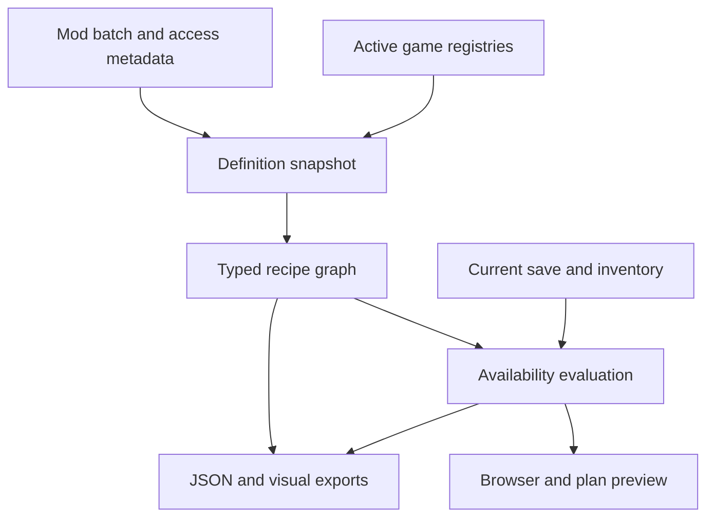

# Crafting index, production graph, and occult expansion

## Status and intended result

**The first in-game browser is implemented in the 1.1.5 source.** Open Production or its recipe picker to reveal the left-edge **Crafting map** tab. The pop-out uses loaded item and recipe registries, a zoomable/pannable graph, click-to-highlight selection, and a lower details panel in muted sage green. The earlier standalone HTML remains a historical source reference. Quantity planning, queue execution, full runtime exports, and the occult production upgrade remain later expansion work. Native build and gameplay status are recorded in [the crafting-map audit](diagnostics/CraftingMapAudit.md).

The intended result is one searchable index in which the player can select any item, see every known way to acquire or manufacture it, follow its ingredients back to their sources, and see what else consumes it. Items without crafting recipes remain in the index with an explanation. The index must describe the actual loaded game and mods when running in-game.

The phrase **crafting tree** describes the presentation. The underlying model is a graph: an item can have several recipes, a recipe can consume and produce several items, recycling can form cycles, and a station can supply something the player cannot manufacture aboard the Magnum. Flattening these relationships into one mandatory recipe would give incorrect costs and availability.

### Current material versus proposed features

| Deliverable or behavior | Status | Scope |
| --- | --- | --- |
| Biomass, pulp, oil, chemical extract, mineral fractions, and ordinary component routes | **1.1.4 source** | Explicit Magnum recipes; existing batch policy and schematic rules apply. |
| Cheap recipes with multiple ingredient types and larger batches | **1.1.4 source, inherited from 1.1.3** | Common recipe helper halves declared ingredient quantities, rounding up with a minimum of one, and doubles declared output batches. Native recipes deliberately retained unchanged, such as Sorbent, remain exceptions. |
| Material coverage log | **1.1.4 source** | Reads registered Magnum and workbench recipes once; reports structural reachability without evaluating quantities, player unlocks, time, station access, or inventory. |
| [Source recipe browser](docs/crafting/recipe-map.html) and [source graph data](docs/crafting/recipe-graph.json) | **Source snapshot** | Relationships extracted from this repository. They are not a capture of the active game or other installed mods. |
| [Raw-material overview SVG](docs/crafting/raw-material-overview.svg) / [PNG](docs/crafting/raw-material-overview.png) | **Source snapshot** | A readable overview of the ordinary manufacturing foundations. |
| [Occult proposal SVG](docs/crafting/occult-proposal.svg) / [PNG](docs/crafting/occult-proposal.png) | **Proposal** | Future occult design; these routes must not appear as existing game recipes. |
| Loaded item and recipe snapshot | **1.1.5 source** | All registered item IDs; Magnum, workbench, station, and recovery routes; current recipe knowledge/cargo and station listings. Unknown native workbench values remain explicit. |
| In-game search and graph pop-out | **1.1.5 source** | Left-edge Production tab, muted sage interface, zoom/pan, click highlighting, and lower details. |
| Complete runtime JSON export, acquisition context, and cost preview | **Later expansion** | Extend the first read-only implementation; quantity planning and queue execution remain separate phases. |
| Occult production upgrade, icon, and zero-ingredient foundation | **Proposed** | See [Occult production interface](#9-occult-production-interface) and the [full occult specification](OCCULT_PRODUCTION_DESIGN.md). |

The current source audit reports 365 explicit Magnum outputs, of which 306 are structurally reachable from its declared raw roots plus preserved native Sorbent. The remaining 59 have contextual acquisition gates; the audit reports no unexplained ordinary leaf ingredients or manufacturing cycles in that source graph. These are **source-audit counts**, not a count of every item or recipe in the native game. The generated graph and [chemistry audit](diagnostics/RawMaterialChemistryAudit.md) are the detailed snapshot records.

## 1. Coverage and boundaries

### Every item has an entry

Index every registered inventory item, including materials, equipment, consumables, ammunition, implants, cyborg parts, deployable packages, trade cargo, data disks, ritual components, quest objects, and unique rewards. An item with zero producers is still searchable. Do not limit the item index to outputs found in recipe tables: that would hide the objects for which the player most needs an explanation.

Non-inventory objects require a separate kind of entry. Ship upgrades, capabilities, and world objects can be linked to items or operations where a verified relationship exists. A deployed turret and its inventory package are different records. A map prop with no pickup or fabrication route should say so rather than receive a generated recipe. Full prop and entity browsing can follow the complete inventory-item index; its coverage must be reported separately.

### Existing acquisition rules remain explicit

The browser is not authority to create missing recipes. Fury Sigil remains purchase-only, Shadowblade remains a finale reward, and quest objectives remain tied to their intended acquisition. Otherworldly materials retain their known salvage, faction, or ritual context until an explicit expansion recipe is authored for them. Unknown acquisition is labeled **unclassified**, rather than silently classified as either craftable or intentionally unavailable.

Player manufacturing and station manufacturing are separate venues. A station recipe consuming packaged freight can be visible without making freight a Magnum ingredient or making that station operation executable by the player. The existing rule that player recipes use loose materials and components remains in force. [Current production design](PRODUCTION_CHAIN_DESIGN.md)

## 2. Verified integration points

These are existing repository usages, not a claim that a complete browser API already exists.

| Concern | Existing evidence | Design consequence |
| --- | --- | --- |
| Registration lifecycle | `AfterConfigsLoaded`, staged `Registrations`, and `FinishIndustryRegistration` in [Plugin.Core.cs](src/Plugin.Core.cs) and [Plugin.Industry.cs](src/Plugin.Industry.cs) | Build a snapshot after registration has completed. Recheck when opening the browser because this mod's hook is not proof that every other mod has finished mutating data. |
| Magnum recipes | `Data.ProduceReceipts`, `OutputItem`, `RequiredItems`, `ProduceTimeInHours`, and receipt IDs in [Plugin.Industry.cs](src/Plugin.Industry.cs) | Read the effective registered recipe, not the unadjusted source declaration. Preserve its native identity. |
| Workbench recipes | `Data.WorkbenchReceipts`, `OutputItem`, and `RequiredItems` in [Plugin.CraftingCoverage.cs](src/Plugin.CraftingCoverage.cs) | Keep a separate workbench adapter. Native timing, yield, and access behavior need installed-version inspection before reporting exact values. |
| Station production | `Data.BarterReceipts`, `BarterReceipt.InputItems`, `OutputItems`, `ProduceTimeInHours`, power gain, and tech gain in [Plugin.GuardSupplies.cs](src/Plugin.GuardSupplies.cs) | A station operation may have several outputs or non-item effects. Preserve the whole operation. |
| Station eligibility | `SupportWorkshops`, `CanUseSupportWorkshop`, `Station.CurrentReceipts`, owner, and faction tech in [Plugin.SupportProduction.cs](src/Plugin.SupportProduction.cs) | Distinguish a registered recipe from one enabled at a particular station now. Ownership and tech can change. |
| Item metadata | `Data.Items.GetRecord`, `GetSimpleRecord<ItemRecord>`, `ItemDesc`, categories, tech level, and `Disassembly` throughout the production files | Use actual item identity and icons. The complete item-table enumeration mechanism must be confirmed against the installed native API; do not invent a `Data.Items.AllItems` member. |
| Recycling and disassembly | `ShredProfiles`, `FinishRecycle`, `ItemRecord.Disassembly`, and quest/locked checks in [Plugin.IndustryRecycling.cs](src/Plugin.IndustryRecycling.cs) | Magnum shredding can override native recovery behavior. A native disassembly record alone does not describe every recovery venue. |
| Batch yield | `IndustryBatches` and the `StartMagnumItemProduction` postfix in [Plugin.Industry.cs](src/Plugin.Industry.cs) | Registered inputs are already discounted; output multiplication is separate. Apply neither transformation twice. |
| Player unlocks | `MagnumCargo.UnlockedProductionItems`, `SharedIndustryRecipes`, native start recipes, and `DatadiskRecord.UnlockIds` | Model the current learned state separately from the possible sources of a recipe. A chip pool is not a grant of every recipe in the pool. |
| Current materials and orders | `MagnumCargoSystem.GetAvailableCargoStorages`, `GetAvailableToProduceCount`, and `ItemProduceOrders` | Use the native inventory and production rules to validate availability. Existing paid orders are distinct from a new plan. |
| Upgrade gates | `MagnumProgression.IsPerkPurchased`, `IsAvailableToUpgrade`, and `MagnumPerkRecord` in [Plugin.ShipSupport.cs](src/Plugin.ShipSupport.cs) | Future crafting capabilities can use existing progression patterns without inventing an unrelated upgrade system. |
| Native-style UI | `RectTransform`, `CommonButton`, `Text`, `Image`, module points, and `MagnumModuleTechTreeWindow.RefreshGrid` in [Plugin.ShipSupportUi.cs](src/Plugin.ShipSupportUi.cs) | There is a practical way to add a module entry and controls. A full graph panel still needs its own implementation and lifecycle handling. |

The current [coverage diagnostic](src/Plugin.CraftingCoverage.cs) is a useful starting point for structural reachability. It does not index every item, station recipe, unlock source, or recovery route and intentionally bounds its log output. Do not present that bounded log as the complete export.

## 3. Active-game index architecture

Separate three concerns: a stable snapshot of registered definitions, a snapshot of the player's current access and inventory, and the views built from those snapshots.

### Definition capture

Create source adapters for Magnum production, field workbenches, station production, native disassembly, mod recycling, and known acquisition records. Each adapter produces plain data. Unity objects, mutable game records, and live inventory references must not escape into an offline export or a background layout task.

Capture on the game's main thread. Indexing and layout may run on copied data afterward if needed. Do not enumerate live Unity state from a worker. The initial implementation can remain entirely on the main thread with bounded work and an explicit progress state; add background layout only if measured graph size warrants it.

Use a snapshot ID and a content fingerprint covering item IDs, recipe identities, inputs, outputs, yields, and requirements. Refresh when opening the window and on an explicit **Refresh game data** action. Refresh save-specific state after returning from production, learning a recipe, loading a save, or changing relevant progression. The exact native change events are an inspection task, not assumed APIs. Until verified, refresh on window open and when the player requests it rather than patching speculative events or scanning every frame.

A snapshot should record game version when discoverable, mod version, capture time, registry coverage, and warnings. If the exact author of a mutated native record is unknown, report **active registered definition; origin unknown**. An `iom_` prefix is useful identification for this mod's records but does not establish ownership of all modified native recipes.

### Player-state capture

Player context includes learned outputs, available capabilities, selected venue, accessible materials, existing production orders, and relevant faction/station state. Keep it outside the definition graph so one captured catalogue can be inspected without a save and compared with several saves.

Available stock must match the native operation's rules, including storage scope and item eligibility. Verify treatment of locked, quest, equipped, damaged, and otherwise reserved items before claiming an exact craftable count. A total stack count across all inventories is not sufficient evidence.

## 4. Graph model

| Node kind | Identity and content | Relationships |
| --- | --- | --- |
| **Item** | Stable native or mod item ID; localized display label, category, icon reference, stack semantics, and record type | Consumed or produced by operations; acquired from sources; used by other objects. |
| **Operation** | Venue plus recipe identity; input/output lists; actual batch yield; time; conditions; deterministic or probabilistic behavior | Ingredient edges into the operation and output edges out of it. Several operations may produce the same item. |
| **Capability** | Recipe unlock, ship perk, workbench availability, faction tech, station ownership, or special access condition | Required by an operation. It is not a consumable ingredient unless native behavior says it is consumed. |
| **Acquisition source** | Mining/gathering, trade, loot, salvage, reward, or a documented external source | Supplies an item with its known conditions; unknown rates remain unknown. |
| **Essence family** | Abstract native ritual classification, such as `gavvakh`, `agga`, or `eon` | Affinity or ritual compatibility edges only; classification does not imply a manufacturing recipe. |
| **World object or upgrade** | A non-inventory record with a verified link to an item, capability, or construction operation | Deployment, installation, or unlock relationships; no automatic item conversion. |

### Alternatives and cycles

An item node must retain every producer. A station supply route, native workbench recipe, Magnum recipe, and salvage route are alternatives, not one merged ingredient list. Preserve duplicate output IDs across venues and distinct recipe IDs within a venue. `IndustryBatches` is currently keyed by output for this mod's custom recipe helper; the general index must not inherit that single-producer limitation.

Use strongly connected components to identify cycles. Show recovery loops as collapsible groups and stop recursive expansion at a previously visited item or operation. Manufacturing reachability can use a fixed-point calculation, as the current diagnostic does. Cost planning needs a selected route and must not treat a cycle as a source of its own initial ingredients.

Separate manufacture, recovery, and acquisition edges in filters. A resource-positive recycling loop is a balance finding to display, not an instruction for the planner to generate unbounded resources. Likewise, a zero-ingredient production order is a real timed source when one is registered; it is not an error simply because it has no incoming material edges.

### Required distinctions

- Native **Gavvakh** inventory item: `quasi_medical_kit_1`.
- Native **Gavvakh essence family**: `gavvakh`; this is not an inventory item ID.
- `demonic_eye` has the **Agga** essence affiliation.
- `quasi_basic_ammo`, displayed as **Igvas**, has the **Eon** essence affiliation.

These identities must remain separate even when lore uses related terms. An affinity edge never authorizes an item-to-item transformation. The [occult specification and its primary exported-record references](OCCULT_PRODUCTION_DESIGN.md) use inventory IDs for consumed and produced goods and capability/affinity nodes for abstract requirements.

## 5. Availability modes

Provide three primary browsing modes, plus an explicit unknown state. Every mode retains access to the full item index.

| Mode | Meaning | Required explanation |
| --- | --- | --- |
| **Craftable now** | At least one operation can be started now in the selected venue, with its unlocks, capabilities, and actual inputs available. | Recipe, venue, startable batch count, and any existing order constraints. |
| **Craftable eventually** | A known manufacturing route exists but needs ingredients, intermediate orders, a schematic, a capability, or another accessible venue. | The precise missing steps and their known acquisition conditions. Do not imply a guaranteed reward or random chip roll. |
| **External only** | No registered manufacturing route is available, and a known purchase, reward, loot, or other external route explains the item. | The supported source and restrictions, such as Fury Sigil purchases or the Shadowblade finale. |
| **Unclassified** | No producer was found and the index does not have enough evidence to explain acquisition. | Missing coverage or unknown source; never silently invent a recipe. |

**Buildable from current stock through intermediate crafts** is a planner result, not a synonym for immediately craftable. A player may have ore for a weapon but still lack several processed parts and the required schematic. The UI should show that distinction in the item's detail panel.

Raw roots also have different meanings. Current ore and water production are timed extraction orders; flesh is gathered biological input. A future zero-ingredient clone order is a proposed capability-gated source. A quest reward is an external source, not a raw root that satisfies every ordinary manufacturing chain.

## 6. Browser and interaction flow

### Entry point and layout

The accepted interface is a **Crafting map** tab on the left edge, visible only while Production or its item-selection window is open. The collapsed tab has a right-pointing handle. Expanding it slides out a panel with a collapse handle at its right edge. Use the same muted sage green as the existing control interface. Concrete native Show/Hide methods for both production windows have been inspected; the entry hooks live in `Plugin.CraftingTreeEntry.cs`. A general ship-screen button is superseded by this requirement.

Use three coordinated areas. The first implementation supplies the graph and current recipe details; broader filtering, acquisition explanations, and quantity planning below remain expansion targets:

1. **Search and filters:** localized name, stable ID, item class, faction, venue, material family, availability, and whether the entry is native, mod-defined, or of uncertain origin.
2. **Graph view:** the selected item, its producer operations, ingredients, and expandable upstream branches. A **Used by** view reverses the relationship to show consumers.
3. **Details and plan:** the selected operation, actual batch inputs and outputs, time, unlock sources, missing requirements, and quantity preview.

Search must find an item with no recipe. A single click highlights a node and updates the lower details panel without changing the pan or zoom. Mouse-wheel zoom follows the pointer; click-drag pans the graph. An explicit focus action or double-click may recenter a different branch. Preserve useful navigation history. Repeated references can appear as compact links to one canonical item node; do not duplicate stock or demand because an item appears in several branches.

The first opening shows a searchable catalogue and material-family overview, not every node drawn simultaneously. Expand one or two dependency levels by default. Let the player expand all upstream dependencies for the selected target, collapse a family, switch to consumers, and switch between Magnum-only and all venues. The full export remains complete even when the visible graph is collapsed.

### Typical player flow

Search for the service Lasgun, select its Magnum recipe, and see the current recipe's plate/stock, fitting, and weapon-component requirements. Expand weapon components to their ordinary metal routes. Change the target quantity; the plan updates the required batches and surplus. Select a missing schematic to see its catalog and supplier context. Return to the item and switch to **Used by** to understand what else needs those components.

For acid, the view shows chemical extract, reactive minerals, and water as separate inputs. Selecting extract opens the biomass branch; selecting reactive minerals opens the ore branch. The player can trace both foundations without losing the acid target. The graph makes these independent material branches visible while retaining their shared use of water and other stock.

For an external-only item, show the item and its acquisition explanation in the same window. No empty graph, fabricated ingredient list, or disabled button with no reason.

### Access and information design

Use icons and labels together for unlocked, missing materials, unavailable venue, external source, cycle, and unknown status. Do not communicate state only through color. Truncated names need readable details. Support zoom, pan, keyboard focus, a text/list equivalent of the selected dependency graph, and sensible behavior at the smallest supported game resolution.

Recipes outside the current player's knowledge should show their unlock requirement by default. Details for story-specific rewards can follow the game's existing discovery rules where those rules can be verified. Do not invent a spoiler lock that prevents ordinary material planning; expose a clearly labeled **All registered definitions** inspection view for development and comprehensive auditing.

## 7. Quantities, cost, time, and queue preview

### Display the effective operation

For this mod's custom Magnum recipes, registered `RequiredItems` already contain the reduced quantities. `IndustryBatches` supplies the multiplier applied to a newly started native order. The browser should show the paid ingredients and finished yield per operation, not halve inputs again or multiply output twice. Station batches and field-workbench outputs keep their own semantics.

Always distinguish an inventory item from ammunition charges or shots. Use the actual production output unit; do not translate twelve ammunition items into twelve shots unless the native record and production behavior establish that relationship.

Show both **one operation** and **requested target** values. If an operation produces four units and the player needs five, it needs two operations and produces three spare units. Include those leftovers in the plan and reuse them in other branches.

### Planning rules

For a chosen deterministic recipe with output batch `b`, the additional operations for deficit `d` are `ceil(d / b)`. Apply that calculation after aggregating demand for shared intermediates. Reserving each branch independently can overbuild components or spend the same stock twice.

The planner should:

1. Read usable inventory and a stable player-state snapshot.
2. Account for existing paid orders separately from available stock. Do not subtract their inputs twice, and do not count unfinished output as immediately available.
3. Aggregate target demand, choose producer alternatives explicitly, and reserve owned inputs once.
4. Expand deficits through eligible recipes, maintaining surplus and reporting external purchases or unknown sources.
5. Stop at a chosen raw or external source, an unavailable requirement, or a cycle without an independently available seed.
6. Display every operation, missing requirement, surplus, and assumption before any future queue action.

Initial route selection should be predictable: prefer usable stock, then the player's selected producer and venue; expose alternatives rather than claiming a globally cheapest plan. A later optimization mode can minimize a stated objective such as time, acquired materials, or number of operations. Do not silently trade away a scarce reward item because its sale price makes it appear cheap.

### Time and scheduling

Show base operation time from the record. Display an effective time only when it can be computed with the same current production modifiers as the native game. Workbench time must remain unknown or use the native behavior once verified; do not copy the Magnum duration by assumption.

Keep three quantities distinct: total production work, elapsed time on one serial line, and elapsed time with a chosen set of available lines. Existing queues, shared ingredients, unlock steps, travel, and trade uncertainty can change completion time. A critical-path estimate is a lower bound until the planner models line capacity and the active queue.

### Execution is a later capability

The first window and planner are read-only. A later **Queue selected operations** action must use the native production entry point and its normal validation, with the correct number of operations rather than the multiplied final item count. Revalidate the inventory, learned recipes, and capacity immediately before starting each operation.

Do not assume that native production supports atomic submission of a whole dependency plan. If it does not, report which operations started and which remain pending; stop safely when state changes. Future outputs cannot be spent before completion. Do not rewrite existing orders, silently cancel work, or create inventory directly to make the plan succeed.

## 8. Export contract

### JSON is the complete machine-readable record

The live exporter should write a versioned snapshot of definitions with optional player context. This is a future format; [recipe-graph.json](docs/crafting/recipe-graph.json) is currently a source-derived snapshot and must retain that provenance.

| Section | Required content |
| --- | --- |
| Header | Schema version, capture kind (`source-snapshot` or `active-game`), snapshot ID, capture time, game/mod versions where known, and coverage flags. |
| Items | Stable IDs, display labels, categories/type, icon reference, stack/unit metadata, known availability classification, and acquisition references. |
| Operations | Stable key, original recipe ID, venue, input/output quantities, batch source, base/effective time with confidence, requirements, and non-item effects. |
| Capabilities and acquisition | Unlocks, chip pools, perks, faction/station conditions, external sources, and source evidence. Random pools remain pools. |
| Relationships | Consumes, produces, requires, acquired-from, affinity, deployment, and recovery, with explicit edge kinds. |
| Optional player context | Learned outputs, capabilities, selected storage scope, available quantities, and queue information necessary for the exported plan. |
| Diagnostics | Missing records, unclassified acquisition, unsupported adapters, cycles, uncertain yields/time, and schema compatibility warnings. |

Every reference must resolve to an exported node or an explicit unresolved-reference record. Sort stable keys for useful diffs. Preserve complete data even if the window currently shows only one branch. Export data as data: imported graph files must never execute code or modify the save.

Do not export arbitrary save fields, credentials, machine paths, or unrelated player data. A catalogue-only export needs no inventory or campaign details. Player-context export should be a separate, clearly named choice because its purpose is reproducing a specific plan.

### Visual and spreadsheet exports

The offline browser can later load an active-game JSON snapshot in addition to the checked-in source snapshot. Its banner must state which one is open and when it was captured. Offline files cannot establish that a currently running game still has the same data.

SVG and PNG exports should include the selected target or scope, venue filter, quantities, source/capture date, status legend, and any collapsed or omitted sections. Offer both a readable selected chain and a material-family overview. Do not compress thousands of nodes into an unreadable poster and call that the only complete map; retain the full searchable graph and complete JSON alongside visual exports.

An eventual Excel workbook should have linked tables for **Items**, **Operations**, **Inputs**, **Outputs**, **Requirements**, **Acquisition**, and **Issues**, plus an optional **Plan** sheet. Keep recipe IDs and item IDs as text. Separate operations from input/output rows so multiple outputs and alternatives survive export. Include raw quantities, effective batch quantities, times and their confidence, venue, unlock state, and source provenance. This is a future deliverable, not an existing spreadsheet or runtime exporter.

## 9. Occult production interface

The expansion should give demon, Chaos, and otherworldly equipment meaningful esoteric supply chains. It should connect ordinary support materials with occult feedstock while keeping faction identity and exceptional acquisition rules visible. The detailed material and recipe proposal belongs in the [Occult chain specification](#occult-chain-specification).

### Foundational source and gate

The requested foundation is a **zero-ingredient, time-consuming production source**, with a fictional raw-clone/torment/suffering chain leading into the native Gavvakh inventory item. Zero ingredient cost must be represented literally where that recipe is authored; do not quietly add biomass, cargo, or an advanced component that makes the proposed foundation depend on its own downstream chain.

That source still has an operation time, batch yield, capability requirement, and production capacity. Initial design default: the source becomes available through an **Occult Production** ship upgrade. It is not a globally shared ordinary material recipe on an unmodified starting ship. Exact names, tiers, costs, and batch yields belong in the occult specification and should remain marked proposed until authored and tested.

The proposed chain represents Raw Clones, Torment Imprints, and Essence of Suffering as inventory intermediates with new, explicitly proposed IDs. They require real item records and icons before implementation. Native essence families remain typed affinity metadata. Never put an essence-family name into `ItemQuantity` merely because its display text resembles an item.

The graph must show every explicitly authored branch, including demonic materials, equipment, consumables, ritual components, and links to ordinary supporting parts. A complete explanation also includes deliberately external or unique endpoints. It must not manufacture Fury Sigil or finale rewards through an accidental generic rule.

### Upgrade implementation pattern

Use the repository's existing `MagnumPerkRecord`, descriptor, parent/child links, `PositionInGraph`, `UpgradePrice`, and translation patterns from [ship support](src/Plugin.ShipSupport.cs) and [Comms Node upgrades](src/Plugin.CommsNode.cs). `IsPerkPurchased` provides a proven way to read an installed capability. A capability requirement in the browser must agree with the actual production gate; a locked icon alone does not enforce access.

Default UI placement is in the engineering area, subject to checking the installed module layout for overlap. The existing support modules demonstrate adding a module point and mapping its camera to an existing ship area if a separate occult module is warranted. The final choice between a branch in an existing module and a distinct module is a layout decision for the first UI prototype, not a reason to delay the data design.

Keep the upgrade and recipe schematics separate. Installing the facility can unlock its foundational source and enable occult operations; higher equipment recipes can retain their individual schematic and faction conditions. Custom data disks continue selecting one recipe. Existing learned recipe IDs must survive any later relocation of their production capability.

### Icon and artwork interface

Create one readable occult-production upgrade icon with a transparent background and a distinct silhouette: an enclosed crucible or vessel with a restrained ritual mark and a violet accent compatible with the game's green interface. Readability at the actual small module-button size takes priority over fine ornament. Test its normal and locked states against the real interface.

Use the existing `MagnumPerkDescriptor` icon fields and `SupportIcon` pattern. Ship support already derives a dim locked sprite from the readable source; a bespoke locked icon is optional if the layout needs clearer differentiation. If new inventory intermediates are added, supply the separate inventory, floor, and shadow resources required by `ApplyItemArtwork`, or explicitly reuse a validated existing set. A new item ID with only a descriptor donor is insufficient under the current artwork helper.

The graph uses each item's real icon, with a distinct icon for an abstract essence or capability. Gavvakh's item icon must not be reused in a way that makes an essence-family node look like another stack of inventory items.

### Occult chain specification

The [full occult production specification](OCCULT_PRODUCTION_DESIGN.md) defines the root chain, proposed intermediate IDs, effective quantities, times, upgrade gates, nine native otherworldly families, and the existing ten-tier Undivided equipment tree. The [proposal flowchart](docs/crafting/occult-proposal.svg) illustrates the starting cycle and the family branches.

| Proposed process | Inputs consumed | Output | Base ship-hours |
| --- | --- | --- | ---: |
| Clone gestation | No item ingredients | 2 Raw Clones | 8 |
| Torment cultivation | 2 Raw Clones | 4 Torment Imprints | 4 |
| Suffering separation | 4 Torment Imprints | 4 Essence of Suffering | 4 |
| Gavvakh condensation | 4 Essence of Suffering | 2 native Gavvakh | 4 |

The initial serial cycle therefore makes two Gavvakh in twenty ship-hours after the required facility is installed. These are proposed final displayed quantities, not arguments to be halved/doubled again by the current helper. Clone tokens are production stock, not members of the crew or spawned enemies.

Family attunements are learned capabilities. They open distinct material branches, such as Gannix tissue/quasibronze, Shartamakhum glass, Duggur plate, and Ur skin/gears/fuel, while ordinary metal, textile, chemical, and electronic ingredients remain useful. The specification also covers Ron, Cattaram, Scrivnus, Flauros, and Olirna, marking the native records that still need enumeration. It does not claim a verified complete native equipment inventory for those families.

Fury Sigil stays purchase-only, Shadowblade stays a finale reward, and Purity Seals stay mission rewards. Every future recipe remains labeled **proposed** until it exists in registered runtime data. The inventory and recipe index must show both implemented and unclassified records honestly.

## 10. Delivery phases and acceptance

| Phase | Deliverable | Acceptance condition |
| --- | --- | --- |
| **0 — Current source documentation** | Source browser/data, ordinary overview, proposal map, and this design | Every visual clearly identifies source snapshot versus proposal. No claim of complete native-game coverage or a shipped runtime window. |
| **1 — Complete read-only capture** | Verified native adapters, full item index, acquisition metadata, and JSON export | Every registered inventory item is represented, even with no producer; all supported recipe tables and custom batch overrides are captured; unknown fields are reported; opening/exporting changes no game state. |
| **2 — In-game browser** | Search, selected-item graph, consumers, venues, unlock explanations, and refresh | Search finds raw materials, ordinary equipment, an external-only reward, and an item with unclassified acquisition. Alternatives and cycles remain navigable. UI teardown leaves no orphan controls or handlers. |
| **3 — Plan preview** | Quantity expansion, shared-stock reservations, surplus, alternative selection, and time estimates | A plan with repeated intermediates never spends the same stock twice; batch rounding matches production; unavailable capabilities and external ingredients remain visible. |
| **4 — Optional queue integration** | Explicitly requested submission of eligible planned operations | Native validation is used, state changes invalidate stale plans, partial submission is explained, and existing orders/save state are not rewritten. |
| **5 — Occult production** | Reviewed chain specification, upgrade/icon, explicit recipes, and graph integration | The foundation is genuinely zero ingredient after its access gate; item and essence identities remain separate; each intended branch has a documented source; reserved items preserve their acquisition rules. |
| **6 — Complete exports and refinement** | Active-data offline browser, SVG/PNG views, Excel tables, and measured UI improvements | Data round-trips without lost alternatives, quantities, or access requirements. Large views remain readable, and performance is measured on a full installed catalogue. |

Phases 1 and 5 can be developed independently after the occult specification is complete. The new graph should discover explicitly registered occult recipes through the same adapters used for ordinary recipes; it should not require a second hardcoded viewer or duplicate recipe database.

### Focused validation cases

- **Ordinary assembly:** the service Lasgun keeps separate material, fitting, and weapon-component inputs; the displayed operation yield agrees with the active recipe and batch override.
- **Branching chemistry:** acid resolves to its organic and mineral foundations; shared water demand is aggregated correctly.
- **Batch rounding:** requesting five units from a four-unit operation produces two operations and three surplus units.
- **Native exception:** existing Sorbent retains its observed free recipe and native behavior; no blanket batch assumption is imposed.
- **Alternative venue:** a station recipe is visible but is not offered as a Magnum queue action.
- **Recovery:** a shred override and native disassembly are correctly distinguished; cyclic recovery cannot hang expansion or planning.
- **Saved progression:** old learned recipes and chips retain identity after a new index version; newly shared foundations display current access without rerolling old chips.
- **Reserved endpoints:** Fury Sigil is explained as purchase-only and Shadowblade as a finale reward; neither receives a synthesized producer.
- **Occult identity:** `quasi_medical_kit_1` and `gavvakh` occupy different node kinds; an affinity never appears as an inventory ingredient.
- **Zero-input source:** a proposed clone source has zero ingredient edges, a nonzero time, the correct output batch, and a real capability gate once implemented.
- **Other mods:** an additional recipe or item appears after refresh; uncertain provenance is reported without assigning it to this mod by guesswork.
- **Failure isolation:** unsupported records or export errors produce diagnostics while ordinary play and native production continue.

## 11. Compatibility, persistence, and remaining decisions

Use stable item IDs and venue-qualified recipe keys. Version the export schema independently from the mod version. Save UI preferences and pinned item IDs separately from recipes and native production orders; a missing pin after a mod removal should be shown as unavailable rather than dereferenced as a valid record.

Do not persist a live index as authoritative campaign state. Rebuild definitions from the loaded registries and resolve saved references against the new snapshot. Plans are provisional and must be revalidated after loading, changing mods, changing version, or learning new recipes. Current production orders retain the quantities and paid ingredients recorded when started; the browser must not recompute their historical payment from a newly changed recipe.

For later occult migration, retain stable IDs when names or presentation change. Recipe relocation must not erase already learned knowledge. If a future release intentionally retires an operation, use a targeted migration with native cancellation/refund behavior where necessary, following the existing Fury Sigil retirement pattern; do not generalize that migration to unrelated orders.

The following decisions remain bounded implementation work, with defaults already chosen:

| Decision | Default | Evidence still needed |
| --- | --- | --- |
| Full native item enumeration | Read the registered item collection once per definition snapshot | Installed native API shape, including composite records and disabled/internal entries. |
| Production entry | Left-edge Crafting map tab on both concrete production windows | Installed-version lifecycle inspection and in-game layout/interaction check. |
| Workbench yield/time/access | Capture only verified fields; mark remaining values unknown | Installed native implementation and a representative workbench operation. |
| Native effective time | Show base time until native modifiers can be reproduced exactly | Current production calculations and queue scheduling behavior. |
| Refresh events | Refresh on opening and by explicit action; avoid per-frame registry scans | Reliable recipe/unlock/progression notifications in the installed build. |
| Planner optimization | User-selected alternatives and deterministic preview | Real use cases before introducing an optimizer or automatic purchase assumptions. |
| Occult module placement | Engineering area; separate module only if it improves layout | Visual check of current module tree and available anchors. |
| Occult production resources | Use explicit Raw Clone, Torment Imprint, and Suffering Essence inventory intermediates | Register new records/artwork and confirm native essence accounting stays separate. |

The main risks are inaccurate native yield assumptions, treating station capability as player access, losing recipe alternatives, hidden inventory eligibility rules, and expensive full-graph layout. Each is addressed by source adapters with explicit coverage, typed relationships, native validation, and a read-only first release. None requires changing working crafting behavior merely to make the map look complete.
