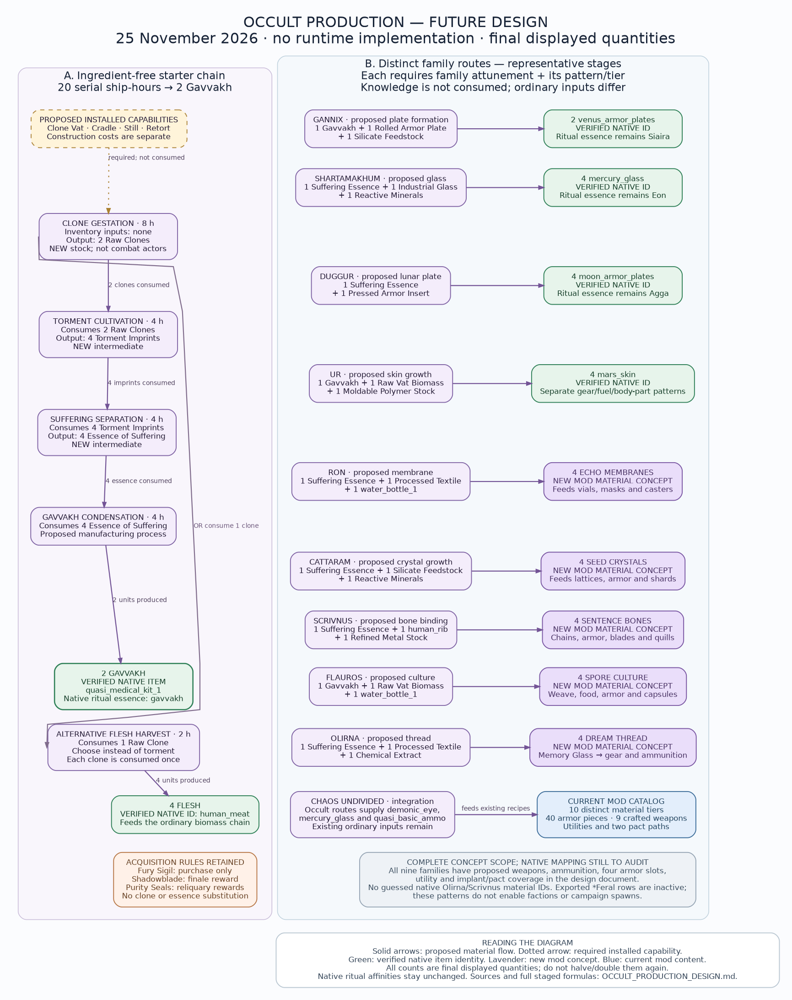

# Future occult production and otherworldly crafting trees

**Status: FUTURE DESIGN PROPOSAL ONLY — 25 November 2026 (America/Anchorage).** No occult runtime recipes, ship upgrade, UI, or artwork have been implemented by this memo. The current Chaos code was inspected at source baseline `de43df89d6b5878422606fa69c43a4c544f2987e`; the implemented ordinary-material foundation work is separate. Proposed identifiers below are explicitly marked and are not claimed to exist in Quasimorph.

## Visual overview

The two panels separate the proposed twenty-hour starter chain from representative family routes. All quantities are final displayed quantities. Native item identities and new mod concepts have different colors; dotted arrows represent installed capabilities, not consumed ingredients. Full equipment concepts and proposed formulas follow below.

[Open scalable diagram](docs/crafting/occult-proposal.svg) · [PNG](docs/crafting/occult-proposal.png) · [Graphviz source](docs/crafting/occult-proposal.dot)

## 1. Resolve Gavvakh before designing the chain

The requested substance is **Gavvakh**. Its native inventory item ID is **`quasi_medical_kit_1`**. The native ritual essence-family ID is **`gavvakh`**. These are different kinds of record and must be different node types in the future crafting window. Do not register an invented native item called `guavah`, `guavakh`, or `gavvakh`.

The direct `config_items` export assigns `quasi_medical_kit_1` to essence `gavvakh`, with power 100 and stability 25. It assigns `demonic_eye` to **Agga**, and `quasi_basic_ammo` to **Eon**. Producing these items through an occult chain must preserve their native essence assignments. A story connection between Gavvakh and Igvas does not make their ritual affinities identical. [N1]

The export is a primary game-data extract, captured in a third-party tooling repository, not a fresh dump of the user's installed build. Its containing commit is dated 16 August 2026. Current installed records and localization must be checked before implementation. Preservation of the installed native item's effects, expiry, and ritual behavior is an implementation requirement; this design does not assert unverified current numerical effects. [N1]

| Concept | Current record or behavior | Proposed treatment |
| --- | --- | --- |
| Gavvakh medicine | Native item `quasi_medical_kit_1`; also a ritual component | Manufacture the same native item at the final step |
| Gavvakh essence | Native essence ID `gavvakh` | Affinity metadata, not a separate inventory object |
| Undivided essence | Existing mod essence `iom_undivided_essence` | Retain separately from all five native essences |
| Bound Ash | Existing `iom_chaos_bound_ash`, Undivided ritual component | Keep its current identity and ritual function |
| Soulforge Ember | Existing `iom_chaos_forge_ember`, Undivided ritual component | Keep its higher-tier identity and ritual function |
| Raw Clone | No verified inventory record for this proposed production stock | New proposed ID `iom_occult_raw_clone`; not a recruit or creature |
| Torment | Existing Chaos enemy uses the `iom_chaos_torment` family | Proposed production is a process, not the enemy; its cargo output is **Torment Imprint**, proposed `iom_occult_torment_imprint` |
| Essence of Suffering | No verified native item with this requested role | Proposed `iom_occult_suffering_essence`; intermediate cargo, not an automatic new native affinity |

The mod already treats native items as potentially having supplemental records: Bound Ash is constructed as a standalone `PactComponentRecord`, while its `demonic_eye` donor obtains inventory defaults from another record. Implementation must inspect the complete Gavvakh item, not only its supplemental pact-component row. [C2]

## 2. What already exists

### Chaos Undivided

There are ten equipment tiers, four individually manufactured armor slots per tier, a regular weapon at tiers 1–9, a utility, a signature material, and a schematic pool. The armor ID suffixes are `_head`, `_torso`, `_legs`, and `_boots`. Each native chip created from a pool learns one selected recipe. Shadowblade at tier 10 is deliberately excluded from fabrication. [C1, C3]

| Tier | Existing material ID | Existing weapon | Existing armor family |
| --- | --- | --- | --- |
| 1 | `iom_chaos_hide_binding` | Fury Fang Knife | Hidewraps |
| 2 | `iom_chaos_shard_glass` | Shard Pistol | Ritual Flak |
| 3 | `iom_chaos_spawn_rib` | Spawnbone Maul | Ribplate |
| 4 | `iom_chaos_binding_icon` | Bound Cleaver | Possessed Carapace |
| 5 | `iom_chaos_talon_actuator` | Warp-Claw Gauntlet | Talon Plate |
| 6 | `iom_chaos_insulated_conduit` | Excruciator Carbine | Forge Carapace |
| 7 | `iom_chaos_fleshmetal_blank` | Fleshmetal Projector | Fleshmetal Plate |
| 8 | `iom_chaos_harvester_feed_block` | Reforged Harvester | Soulforge Siege Plate |
| 9 | `iom_chaos_infernal_seal` | Hellforged Blade | Hellforged Panoply |
| 10 | `iom_chaos_shadow_anchor_fragment` | **Shadowblade: finale reward** | Shadowbound Plate |

Current Chaos recipes still depend on special native leaves, principally `demonic_eye`, `mercury_glass`, and `quasi_basic_ammo`. They also deliberately cross into ordinary textile, metal, electrical, ammunition, medical, and cybernetic chains. A future occult foundation should close those special input routes without replacing those meaningful ordinary-material connections. [C1]

Two five-rank pact paths already exist: Ravage and Veil. Bound Ash supplies stable Undivided ritual material; Soulforge Embers supply stronger material. The mod has native-essence affinities, tier-specific curse thresholds, ritual upgrades/downgrades/sidegrades, and failed-ritual output. Use these systems; do not introduce a parallel pact currency that bypasses their rules. [C2]

### Otherworldly implants and replacements

Existing quasi cybernetics are already differentiated among Tezctlan, Xiomara, Emeraldlight, Church Gannix, and Shedu. They use such native inputs as `quasi_venus_rags`, `venus_armor_plates`, `venus_weapon_parts`, `mars_gear`, and `mars_skin`. Their equipment slots include Body, Shoulder, Feet, Head, Chest, and Knee. Shedu station production also assembles six verified native replacement-part IDs: `mars_cyborg_head`, `mars_cyborg_chest`, `mars_cyborg_stomach`, `mars_cyborg_knee`, `mars_cyborg_hand`, and `mars_cyborg_leg`. These station lines are not evidence of existing Magnum recipes for every output. [C4]

## 3. Proposed root chain: no starting item ingredients

Install the occult module first. Its construction and upgrades may cost ordinary materials and time. Once installed, its first production order consumes **no inventory item**. The fiction is a self-contained clone culture and containment system; it does not recruit, sacrifice, or remove an actual crew member.

All numbers in the following tables are **proposed final quantities shown to the player**, after any common input/output balancing. They are not raw arguments for the existing helper. Implementers must not halve and double these figures again by accident.

| Process | Final consumed inputs | Final batch output | Initial tuning | Requirement |
| --- | --- | --- | --- | --- |
| Clone gestation | None | 2 Raw Clones | 8 ship-hours | Installed clone vat; one occupied production lane |
| Torment cultivation | 2 Raw Clones | 4 Torment Imprints | 4 ship-hours | Installed containment cradle |
| Suffering separation | 4 Torment Imprints | 4 Essence of Suffering | 4 ship-hours | Installed essence still |
| Gavvakh condensation | 4 Essence of Suffering | 2 native Gavvakh | 4 ship-hours | Installed retort |

The prototype therefore produces two Gavvakh from no starting cargo in twenty serial ship-hours. Those timings are tuning proposals, not native-game facts. An additional vat or retort can improve parallel throughput later without changing recipe quantities. Start with one lane and a finite order queue so a zero-input recipe still has an explicit production commitment.

Use item tokens for clones and imprints. Do not spawn combat creatures inside the ship or use the existing Torment monster as an ingredient. Each process consumes its input tokens once. A clone cannot be both harvested and processed through torment. The UI can describe this as occult industrial production without simulating individual acts of torture.

An **alternative harvest** branch consumes the same Raw Clone stock and supplies the ordinary biomass chain. These are proposed single-output orders. The source export verifies all three output IDs; the flesh, skin, and bone formulas are new design proposals. [N1, N2]

| Alternative harvest order | Final consumed input | Final output | Time | Requirement |
| --- | --- | --- | --- | --- |
| Flesh harvest | 1 Raw Clone | 4 `human_meat` | 2 ship-hours | Clone Vat and harvest pattern |
| Skin harvest | 1 Raw Clone | 4 `human_skin` | 2 ship-hours | Clone Vat and skin pattern |
| Bone harvest | 1 Raw Clone | 4 `human_rib` | 2 ship-hours | Clone Vat and bone pattern |

One clone is consumed by exactly one selected order: flesh, skin, bone, or torment. These are alternatives, never simultaneous byproducts. Flesh can feed the existing Raw Vat Biomass recipe; that connects the ingredient-free clone root to ordinary materials as well as occult manufacture. No crew member, combat actor, bounty, or quest reward is created by these orders.

## 4. Distinct native branches

The native faction export establishes nine separate feral bramfatura categories. Keep the categories distinct from their campaign factions: for example `Gannix` is not the same ID as `Tezctlan`, `XiomaraMasks`, or `ChurchGannix`; `Ur` is not `SheduThousand`. [N4]

All nine corresponding `*Feral` faction rows have `Enabled=FALSE` in that export. They establish classifications and item categories, not nine active campaign factions. Adding production patterns does not enable those factions, alter ownership, or add campaign spawns. Installed faction state remains an implementation audit item. [N4]

The following are verified IDs suitable for a future inventory audit. This is not an invented complete native equipment list. Each branch must be expanded from installed item and recipe records before its production catalog is declared complete.

| Branch | Verified native materials or products | Proposed identity and finished-slot coverage |
| --- | --- | --- |
| **Gannix** | `venus_guts`, `quasi_venus_rags`, `quasi_venus_feather`, `venus_armor_plates`, `venus_melee_parts`, `venus_weapon_parts`, `quasi_darts_ammo`, `quasi_basic_ammo` | Living tissue, quasibronze, feathers, and ritual weapons. Cover melee/ranged weapons, compatible ammunition, four armor slots, and existing Gannix-related implants. Keep Tezctlan, Xiomara, Emeraldlight, and Church patterns distinct. |
| **Shartamakhum** | `mercury_guts`, `mercury_scales`, `mercury_rags`, `mercury_glass`, `quasi_energy_ammo` | Glass, scales, membranes, and energy weapons. Cover optics, ammunition, weapons, four armor slots, and any verified native augmentations. |
| **Duggur** | `moon_guts`, `moon_armor_plates`, `moon_weapon_parts`, `quasi_bolts_ammo` | Bone, lunar plate, and mechanisms. Cover blunt/piercing weapons, bolts, protective pieces, and the native pact line without assuming all components share one essence. |
| **Ur** | `mars_gear`, `mars_skin`, `mars_gas_ammo`; six `mars_cyborg_*` replacements listed above | Furnace-grown skin, mechanical parts, and flame fuel. Cover weapons/ammunition, four armor slots, replacement body parts, and existing Shedu implants. |
| **Ron** | `ron_blood`, `ron_moonshine`, `ron_tentacle`, `ron_mask_1`, `quasi_ron_medicine_1` | Blood, organic membranes, masks, and Soma. Cover native medicines, masks/armor, weapons and pacts only where their records verify those roles. |
| **Cattaram** | `cattaram_geode`, `cattaram_stone`, `cattaram_mine` | Crystalline growth, repair material, and mineral ordnance. Cover native equipment discovered in the export; `cattaram_stone` is a repair item, not generic loose stone. |
| **Scrivnus** | `skrivnus_knife`, `impaler` | Bone and punitive relics. Family spelling is **Scrivnus** in the faction category, while the verified weapon ID uses **skrivnus**. New Sentence Bone and Binding Chain concepts below give it a full proposed material route; mapping the native gear remains an inventory task. |
| **Flauros** | `jupiter_guts`, `jupiter_mushrooms`, `jupiter_grass`, `jupiter_goulash`, `spore_mine`, `flauros_ammo` | Fungal cultures, food, and spore ordnance. Cover verified native weapons/armor, ammunition, consumables and pacts. |
| **Olirna** | Category `Olirna` verified; `quasi_repair_kit` includes that category | New Dream Thread, Memory Glass, and dream equipment below form a proposed mod branch. Dedicated native raw stocks and full native equipment IDs remain an inventory task. The proposed dream theme is a design choice, not a claim about unverified native lore. |

These material IDs and classifications come from the exported repair, ammunition, pact-component, and faction tables. A supplemental pact-component row proves identity and ritual properties; it does not by itself prove the item's primary class, compatible equipment, or complete production recipe. [N1–N4]

### Prototype transformations

Learn a family attunement once through its existing faction, encounter, or research progression. Attunement is knowledge or an upgrade prerequisite, not a rare consumable required on every batch. After attunement, its raw branch can be supplied from the clone/essence root and ordinary refined materials. This retains discovery and faction progression while supporting repeatable manufacture.

| Proposed order | Final consumed inputs | Final output | Required knowledge |
| --- | --- | --- | --- |
| Agga manifestation | 2 Suffering Essence + 1 Industrial Glass | 2 `demonic_eye` | Agga pattern; native component remains Agga |
| Gannix tissue growth | 1 Suffering Essence + 1 Raw Vat Biomass | 4 `quasi_venus_rags` | Gannix tissue attunement |
| Quasibronze formation | 1 Gavvakh + 1 Rolled Armor Plate + 1 Silicate Feedstock | 2 `venus_armor_plates` | Gannix metal pattern |
| Gannix mechanism growth | 1 Gavvakh + 1 `weapon_parts` | 2 `venus_weapon_parts` | Gannix weapon pattern |
| Igvas preparation | 1 Gavvakh + 1 Chemical Extract | 12 `quasi_basic_ammo` | Compatible ammunition pattern; native essence remains Eon |
| Mercury glass formation | 1 Suffering Essence + 1 Industrial Glass + 1 Reactive Minerals | 4 `mercury_glass` | Shartamakhum glass attunement |
| Mercury membrane growth | 1 Suffering Essence + 1 Processed Textile | 4 `mercury_rags` | Shartamakhum tissue attunement |
| Mercury cell preparation | 1 Gavvakh + 1 `mercury_glass` + 1 Cell Stock | 12 `quasi_energy_ammo` | Compatible energy-ammunition pattern |
| Lunar plate formation | 1 Suffering Essence + 1 Pressed Armor Insert | 4 `moon_armor_plates` | Duggur plate attunement |
| Lunar mechanism growth | 1 Suffering Essence + 1 `weapon_parts` | 4 `moon_weapon_parts` | Duggur weapon pattern |
| Lunar bolt preparation | 1 Gavvakh + 1 `rod_parts` | 12 `quasi_bolts_ammo` | Compatible bolt-ammunition pattern |
| Ur skin growth | 1 Gavvakh + 1 Raw Vat Biomass + 1 Moldable Polymer Stock | 4 `mars_skin` | Ur tissue attunement |
| Ur gear formation | 1 Gavvakh + 1 Armor Fittings + 1 Rolled Armor Plate | 4 `mars_gear` | Ur mechanism attunement |
| Ur fuel preparation | 1 Gavvakh + 1 Organic Oil | 12 `mars_gas_ammo` | Ur fuel pattern; remains distinct from ordinary `gas_ammo` |
| Shedu replacement assembly | 1 `mars_gear` + 1 `mars_skin` + 1 Servo Cartridge | 2 of one selected, verified replacement part | Existing replacement pattern and at least its current tier; review each part individually |
| Ron blood cultivation | 1 Suffering Essence + 1 `water_bottle_1` | 4 `ron_blood` | Ron attunement |
| Soma preparation | 2 `ron_blood` + 1 Chemical Extract | 2 `quasi_ron_medicine_1` | Ron medicine pattern; keep its native Agga affinity |
| Cattaram mineral growth | 1 Suffering Essence + 1 Silicate Feedstock + 1 Reactive Minerals | 4 Seed Crystals — new mod material | Cattaram attunement |
| Cattaram repair growth | 1 Seed Crystal + 1 Gavvakh | 2 `cattaram_stone` | Cattaram repair pattern |
| Flauros nursery | 1 Gavvakh + 1 Raw Vat Biomass + 1 `water_bottle_1` | 4 Spore Culture — new mod material | Flauros cultivation pattern |
| Flauros food growth | 1 Spore Culture + 1 Raw Vat Biomass | 4 `jupiter_mushrooms` | Flauros food pattern |

All rows are game abstractions and proposed formulas. None is a claim that the native game already has that recipe. Where a native record already has a recipe, decide deliberately whether to preserve it as an alternative; the current `IndustryRecipe` helper replaces the existing Magnum input list rather than adding another recipe. [C7]

### Full equipment coverage by family

**Every named equipment concept in the following table is a future mod proposal unless explicitly labeled current or native.** These names are not asserted to be native records or existing artwork. The implementation audit may map a concept to suitable verified native gear; otherwise it needs a new mod-owned record and its own pattern. All four armor slots are individual outputs. Family attunement opens material knowledge; each finished item still requires its own pattern and appropriate tier.

| Family | Upstream route and components | Weapons and ammunition | Head / torso / legs / boots | Utility | Implant or pact branch |
| --- | --- | --- | --- | --- | --- |
| Gannix | Suffering Essence + biomass → native Gannix tissue; Gavvakh + ordinary plate/minerals → native quasibronze and weapon parts | Ritual Blade; Veinspitter; native darts or Igvas only after compatibility verification | Feather Hood / Vine Cuirass / Tendon Greaves / Root Boots | Blood Seal Dressing | Current Tezctlan, Xiomara, Emeraldlight and Church Gannix implants remain separate patterns |
| Shartamakhum | Suffering Essence + industrial glass/minerals → native Mercury glass; textile → native Mercury membrane | Glass Slicer; Prism Staff; native `quasi_energy_ammo` where compatible | Mirror Veil / Scale Mantle / Sand Greaves / Glass Treads | Refraction Ward | Facet Lens, proposed head implant; preserve native pact lines |
| Duggur | Suffering Essence + ordinary inserts/mechanisms → native lunar plate and parts | Grave Maul; Bone Thrower; native `quasi_bolts_ammo` where compatible | Ossuary Mask / Rib Harness / Bone Greaves / Marrow Boots | Grave Brace | Grave Oath, proposed pact concept; native skull mapping requires audit |
| Ur | Gavvakh + biomass/polymer → native Mars skin; fittings/plate → native Mars gear; oil → native Mars fuel | Cinder Cutter; Furnace Lance; native `mars_gas_ammo` where compatible | Furnace Helm / Forge Shell / Iron Greaves / Cinder Treads | Heat Seal Patch | Current Shedu implants and six verified Mars replacement slots; keep existing minimum tiers |
| Ron | Suffering Essence + water → native Ron blood; textile + water → new Echo Membrane and Echo Vials | Undertow Blade; Echo Caster; new Echo Vial ammunition | Echo Mask / Tide Mantle / Membrane Leggings / Undertow Boots | Native Soma via its proposed production pattern | Tide Lung, proposed chest implant; native Ron pacts stay independently gated |
| Cattaram | Suffering Essence + minerals → new Seed Crystals; glass/wire → Resonance Lattice | Facet Hammer; Prism Lance; new Resonance Shards | Geode Crown / Crystal Cuirass / Lattice Greaves / Stone Treads | Native `cattaram_stone` through repair growth | Prism Lattice, proposed body implant; native Cattaram ritual paths retained |
| Scrivnus | Harvested native rib + Suffering Essence + metal → new Sentence Bone; metal tread → Binding Chain | Sentence Blade; Sentence Thrower; new Bone Quills; separately audit native `skrivnus_knife` and `impaler` | Judgement Mask / Bone Cage / Chain Greaves / Iron Soles | Sentence Seal | Pain Witness, proposed pact concept; no automatic native skull replacement |
| Flauros | Gavvakh + biomass/water → new Spore Culture; textile → Mycelial Weave; culture → native fungal food | Mycelial Hook; Spore Sower; new Spore Capsules; native ammunition compatibility still audited | Fungal Hood / Mycelium Coat / Root Leggings / Moss Boots | Native fungal foods plus proposed Culture Dressing | Symbiotic Node, proposed body implant; native Flauros pacts retained |
| Olirna | Suffering Essence + textile/chemical extract → new Dream Thread; glass/capacitor → Memory Glass | Dream Needle; Echo Bow; new Waking Shards | Veiled Crown / Dream Mantle / Thread Leggings / Hush Boots | Lucid Salve | Somnial Veil, proposed head implant, and a separately researched Dawn Vow pact concept |
| Chaos Undivided | Existing ten signature materials, now supplied by occult native leaves plus distinct ordinary stock | Current nine crafted weapons; current ammunition lines; **Shadowblade stays a reward** | Current forty separate armor pieces across ten tiers | Current ten utilities | Current Ravage and Veil paths; **Fury Sigil stays purchase-only** |

The proposed weapon, armor, utility, and augmentation designs need distinct stats and tradeoffs during implementation. The matrix establishes a complete content scope; it does not claim that all these items currently exist or share one generic recipe.

### Staged formulas for the five branches needing more original material design

The identifiers below are **proposed new mod IDs**, not guessed native IDs. They reserve an explicit vocabulary for the design. A later implementation must check collisions and register every chosen new item deliberately.

| Proposed new material or ammunition | Proposed mod ID |
| --- | --- |
| Ron Echo Membrane / Echo Vial | `iom_occult_ron_echo_membrane` / `iom_occult_ron_echo_vial` |
| Cattaram Seed Crystals / Resonance Lattice / Resonance Shards | `iom_occult_cattaram_seed_crystal` / `iom_occult_cattaram_resonance_lattice` / `iom_occult_cattaram_resonance_shard` |
| Scrivnus Sentence Bone / Binding Chain / Bone Quills | `iom_occult_scrivnus_sentence_bone` / `iom_occult_scrivnus_binding_chain` / `iom_occult_scrivnus_bone_quill` |
| Flauros Spore Culture / Mycelial Weave / Spore Capsules | `iom_occult_flauros_spore_culture` / `iom_occult_flauros_mycelial_weave` / `iom_occult_flauros_spore_capsule` |
| Olirna Dream Thread / Memory Glass / Waking Shards | `iom_occult_olirna_dream_thread` / `iom_occult_olirna_memory_glass` / `iom_occult_olirna_waking_shard` |

Each row below consumes the listed final quantities, produces one specified output kind, and requires the named family's attunement plus the relevant component or item pattern. Proposed equipment names denote new mod concepts, not native IDs. The numbers are final effective batch counts.

| Family / stage | Final consumed inputs | Final output | Initial time |
| --- | --- | --- | --- |
| Ron membrane | 1 Suffering Essence + 1 Processed Textile + 1 `water_bottle_1` | 4 Echo Membranes | 4 h |
| Ron ammunition | 1 Echo Membrane + 1 `ron_blood` + 1 Industrial Glass | 12 Echo Vials | 3 h |
| Ron head armor | 1 Echo Membrane + 1 Fitted Armor Liner + 1 `lens` | 2 Echo Masks | 6 h |
| Ron weapon | 1 Echo Membrane + 1 `weapon_parts` + 1 `lens` | 2 Echo Casters | 10 h |
| Cattaram seed growth | 1 Suffering Essence + 1 Silicate Feedstock + 1 Reactive Minerals | 4 Seed Crystals | 4 h |
| Cattaram lattice | 1 Seed Crystal + 1 Industrial Glass + 1 `wire` | 4 Resonance Lattices | 4 h |
| Cattaram torso armor | 1 Resonance Lattice + 1 Pressed Armor Insert + 1 Armor Fittings | 2 Crystal Cuirasses | 8 h |
| Cattaram ammunition | 1 Seed Crystal + 1 Cell Stock | 12 Resonance Shards | 3 h |
| Scrivnus bone binding | 1 Suffering Essence + 1 `human_rib` + 1 Refined Metal Stock | 4 Sentence Bones | 4 h |
| Scrivnus chain | 1 Sentence Bone + 1 `metal_tread` | 4 Binding Chains | 3 h |
| Scrivnus head armor | 1 Sentence Bone + 1 Binding Chain + 1 Fitted Armor Liner | 2 Judgement Masks | 6 h |
| Scrivnus weapon | 1 Sentence Bone + 1 `weapon_parts` | 2 Sentence Blades | 8 h |
| Scrivnus ammunition | 1 Sentence Bone + 1 Chemical Extract | 12 Bone Quills | 3 h |
| Flauros culture | 1 Gavvakh + 1 Raw Vat Biomass + 1 `water_bottle_1` | 4 Spore Culture | 5 h |
| Flauros weave | 1 Spore Culture + 1 Processed Textile | 4 Mycelial Weave | 4 h |
| Flauros head armor | 1 Mycelial Weave + 1 Fitted Armor Liner + 1 Moldable Polymer Stock | 2 Fungal Hoods | 6 h |
| Flauros ammunition | 1 Spore Culture + 1 `tin` + 1 `gas_ammo` | 12 Spore Capsules | 3 h |
| Olirna thread | 1 Suffering Essence + 1 Processed Textile + 1 Chemical Extract | 4 Dream Thread | 4 h |
| Olirna glass | 1 Dream Thread + 1 Industrial Glass + 1 `capacitor_parts` | 4 Memory Glass | 5 h |
| Olirna torso armor | 1 Dream Thread + 1 Memory Glass + 1 Fitted Armor Liner | 2 Dream Mantles | 8 h |
| Olirna ammunition | 1 Memory Glass + 1 Cell Stock | 12 Waking Shards | 3 h |
| Olirna weapon | 1 Memory Glass + 1 `weapon_parts` + 1 `wire` | 2 Echo Bows | 10 h |

The remaining armor slots use their own family material with appropriate ordinary fittings: lenses or bindings for headpieces, plates and liners for torso protection, textile and joints for leggings, and rubber or actuators for boots. Give each an explicit reviewed recipe during implementation, with two or three ingredient types and at least two outputs. Utilities, implants, and pacts retain separate knowledge requirements; their effects and native mappings are implementation decisions, not reasons to leave the conceptual family tree empty.

## 5. Complete the Undivided trees without flattening them

Keep all existing tier-specific weapons, armor pieces, utilities, and schematic pools. Add the occult branches as upstream producers of their existing materials. The initial integration should close `demonic_eye`, `mercury_glass`, and `quasi_basic_ammo`, which immediately benefits current Chaos recipes, instead of replacing ten separate materials with one universal token. [C1]

Retain the following manufacturing identities:

- **Cult and hidework, tiers 1–2:** tissue, textile, hides, shard glass; light gear and quasi ammunition.
- **Ossuary and binding, tiers 3–4:** bone stock, binding icons, liners and fitted armor; heavy melee and protection.
- **Talon and forge, tiers 5–6:** actuators, conductors, cells, shock supplies; assault equipment and Soulforge material.
- **Fleshmetal and siege, tiers 7–8:** reinforced plate, feed mechanisms, repair components; heavy ranged equipment and siege armor.
- **Infernal and shadow, tiers 9–10:** infernal seals, anchor fragments, advanced clinical material; high Chaos protection, existing capstone utility, and relic repair.

Any future bespoke armor family should expose head, torso, legs, and boots as separate learned outputs. Where the game has verified vest/backpack, utility, augmentation, or pact records, expose those separately. Do not silently create missing native slots or advertise a four-piece native set before verifying that the records exist.

For ordinary repeatable equipment, propose at least two output units per order, consistent with the accepted batch direction. Ammunition uses larger packets. Unique rewards and acquisition-only items have **no fabrication batch** and are not forced into the two-output rule.

## 6. Harvest, consumption, recycling, and progression constraints

1. **Exclusive consumption:** a Raw Clone token is spent by one process. A Torment Imprint is spent by separation. Suffering Essence is spent by condensation or a selected branch. Native Gavvakh is then either consumed medically, used in a ritual, or spent in fabrication; each use removes the same actual inventory stack.
2. **No combat farming from production:** clone stock is not a summon, mercenary, mission victim, or enemy. Never obtain Warp Scrip, skulls, quests, or faction rewards by creating or processing it. Current hostile-kill rewards already exclude allies, summoned creatures, Eccolapse return, and repeated deaths of the same creature. Preserve those rules. [C5]
3. **Native behavior retained:** crafted native medicines, ammunition, repair items, and body parts use their existing records. Preserve relevant decay, compatibility, addiction, Quasimorphosis, repair behavior, ritual essence and native stack limits. Do not grant permanent storage immunity as an accidental side effect of production.
4. **Recycling remains lossy:** return a limited amount of verified family stock or a clearly proposed inert residue; never regenerate Raw Clones or full Suffering Essence from a finished item. Evaluate production-plus-recycling cycles using final effective batch quantities. Manufacturing, disassembly, ritual failure, sale, and buyback are separate edges in that check.
5. **No blanket recipe synthesis:** native `Disassembly` is evidence for salvage, not permission to manufacture every quest item, relic, pact, organ, or hidden enemy-only weapon. Exclude story records and implicit weapon ammunition unless individually reviewed.
6. **Unlocks remain separate from materials:** shared raw roots do not automatically teach every finished recipe. Retain faction tiers, one-recipe-per-chip behavior, family research, and existing mission prerequisites.
7. **Fury Sigil remains purchase-only:** `iom_chaos_skull_fury_sigil` has no new producer, recycler, essence conversion, clone harvest, or ritual sidegrade into it. Its existing purchased copy can still evolve through the permitted pact rules. [C2, C6]
8. **Shadowblade remains the finale reward:** `iom_chaos_shadowblade` stays outside fabrication. `iom_chaos_shadow_anchor_fragment` can remain a repair and Shadowbound-armor material without creating another blade. [C1, C3, C5]
9. **Purity Seals remain reward-gated:** `iom_purity_seal` stays tied to the existing reliquary reward and relevant Imperial recipes. Suffering Essence, Gavvakh, raw clones, and occult research do not substitute for it. [C8]
10. **Queue correctness:** enforce the installed upgrade and required knowledge when starting an order, not only by hiding buttons. Cancellation refunds only reserved inputs for unfinished work; completed outputs cannot also receive a full refund. Save/load must preserve progress, capacity, and upgrade requirements.

## 7. Occult Production ship upgrade and icon specification

**Proposed module name:** Occult Production. **Proposed module ID:** `iom_occult_production` — new mod-owned identifier, not a verified native module.

The existing ship support code supplies a useful integration pattern: `MagnumPerkRecord`, `MagnumPerkDescriptor`, module localization, parent/child perks, prices, grid positions, purchase checks, and a known `engineer` camera/UI anchor. Reuse that pattern in a separately scoped module. Do not assume a new native occult room or camera anchor exists. Native pact/Morphanal access remains independent. [C9]

| Proposed upgrade | Unlocks | Initial design constraint |
| --- | --- | --- |
| Clone Vat | No-item gestation; two Raw Clones per batch | One production lane; ordinary construction cost |
| Containment Cradle | Torment Imprints | Requires Clone Vat; consumes stock rather than generating combat actors |
| Essence Still | Essence of Suffering | Requires Cradle; small stackable output batches |
| Gavvakh Retort | Native Gavvakh | Requires Still; native item behavior retained |
| Attunement sockets | Separate family raw-material recipes | Research or existing faction/encounter discovery per family |
| Soulforge annex | Undivided high-tier material throughput | Requires relevant Chaos tier and existing pattern; does not unlock the finale reward |
| Expanded capacity | Additional simultaneous work | Throughput upgrade, not a global reduction of every occult ingredient cost |

Construction prices are not assigned final numbers here. Prefer already craftable ordinary refined materials so installing the first module does not require its own output. No Gavvakh or Suffering Essence is required to start the initial chain.

### Icon art brief — no art generated

- Match the existing ship-perk asset size: inspected `GunMount.png`, `MercenaryPod.png`, and `SupplyPod.png` are **36 × 36 RGBA**. Author the icon at native size and verify it at that size; a larger preview is only a review aid.
- Central silhouette: a sealed vertical clone vat inside a dark metal arch; a small suspended violet droplet over a retort at its base. One restrained bone-colored binding ring communicates containment. Avoid text and detailed anatomy.
- Palette: charcoal and aged iron body, bone highlights, a small violet or cold-green essence accent. It must remain readable alongside the existing dark ship UI and its selection tint.
- Keep transparent outside pixels, crisp pixel edges, and a clear one-pixel silhouette break. Do not bake a tooltip, cost, recipe arrow, hover frame, or padlock into the base image.
- Locked treatment should follow the existing `SupportIcon(... locked: true)` darkened derivative; selection and focus remain UI states. Family attunements should use distinguishable silhouettes, not color alone.
- Suggested **proposed** asset key: `OccultProduction`; separate keys may later represent Clone Vat, Essence Still, and Gavvakh Retort. These assets do not exist yet. [C9]

## 8. Crafting-tree integration and acceptance boundary

The future window needs typed records for **items, recipes, ship upgrades, recipe knowledge, external acquisition, and essence affinities**. It should show exact registered item IDs internally and localized names to the player. A material route should distinguish “materials obtainable” from “recipe learned” and “required facility installed.”

Allow inspection of upstream ingredients and downstream uses, including the medical, ritual, fabrication, and salvage uses of Gavvakh. Show a branch's currently blocked prerequisite without presenting planned formulas as live recipes. A selectable batch count must use effective outputs and whole-item input rounding. Bind the tree to the runtime registered graph so additions from native data and other mods appear in the correct state.

Before calling the future otherworldly tree complete:

1. Export installed item records, localization, recipes, workbench recipes, disassembly, essences, affinities, native skull progression, and upgrade requirements.
2. Enumerate every eligible native and mod item for each of the nine families and Undivided; classify quest/reward/purchase-only and enemy-only exclusions explicitly.
3. Close the base occult chain with zero starting cargo after module installation, then verify each family route from that root plus ordinary raw sources.
4. Audit gear slots and compatible ammunition per family, not by guessed ID prefixes alone.
5. Test reachable materials and learned access separately; verify save/load, cancellation, decay, native potion effects, rituals, and recycling cycles.
6. Verify the three protected acquisition rules above, including alternative recipes and ritual edges.
7. Only then implement additional single-god Chaos or new otherworldly equipment branches as a separately scoped content expansion. This memo does not claim those are current game catalogs.

### Explicit unknowns

Current installed Gavvakh record fields and native recipe availability; complete native gear and augmentation lists for every family; dedicated Olirna raw stock; full Scrivnus raw stock; native ship-upgrade room integration beyond existing support patterns; final construction prices, production times and capacity; native decay timing in the installed build; and the release-level treatment of alternative recipes. These require the installed-data export and a later gameplay implementation pass.

## Source register

**Primary exported game data:** immutable repository commit `e6e557f1f679da0b2462ba2862296e08bd70cd28` (16 August 2026). The source mapping explicitly identifies these as copies of original game configuration sections; this is not an installed-game snapshot.

- **N1:** [Pact components: IDs, essence assignments, power and stability](https://github.com/Raigir/Quasimorph-Mod-Tool/blob/e6e557f1f679da0b2462ba2862296e08bd70cd28/ref/base/pactcomponents.txt), blob `dd183136b59bf39a6fa1f718a40a60140cfbc504`. [Configuration source matrix](https://github.com/Raigir/Quasimorph-Mod-Tool/blob/e6e557f1f679da0b2462ba2862296e08bd70cd28/REF_DATA_MATRIX.md).
- **N2:** [Native repair records and family categories](https://github.com/Raigir/Quasimorph-Mod-Tool/blob/e6e557f1f679da0b2462ba2862296e08bd70cd28/ref/base/repairs.txt), blob `16c3cfc5abb4d70a78566eb2bedfa308efd3409d`.
- **N3:** [Native ammunition records](https://github.com/Raigir/Quasimorph-Mod-Tool/blob/e6e557f1f679da0b2462ba2862296e08bd70cd28/ref/base/ammo.txt), blob `8836099bd903284c9d633ca2d48874ca35999923`.
- **N4:** [Native faction records, including nine feral categories](https://github.com/Raigir/Quasimorph-Mod-Tool/blob/e6e557f1f679da0b2462ba2862296e08bd70cd28/ref/base/factions.txt), blob `6d0f17909dc541eb98388ae636d897ab793fa0ba`.

**Project primary source, baseline `de43df89d6b5878422606fa69c43a4c544f2987e`:**

- **C1:** [Chaos production and recipe exclusions](https://github.com/mrcalzon02/ImperiumOfMan/blob/de43df89d6b5878422606fa69c43a4c544f2987e/src/Plugin.ChaosProduction.cs).
- **C2:** [Undivided essence, pact records, affinities, and Fury Sigil ritual protection](https://github.com/mrcalzon02/ImperiumOfMan/blob/de43df89d6b5878422606fa69c43a4c544f2987e/src/Plugin.ChaosPacts.cs).
- **C3:** [Ten-tier Chaos gear, armor slots, utilities and Shadowblade](https://github.com/mrcalzon02/ImperiumOfMan/blob/de43df89d6b5878422606fa69c43a4c544f2987e/src/Plugin.ChaosEquipment.cs).
- **C4:** [Native/custom cybernetics and replacement lines](https://github.com/mrcalzon02/ImperiumOfMan/blob/de43df89d6b5878422606fa69c43a4c544f2987e/src/Plugin.CyberneticsCatalog.cs); [fabrication versus station registration](https://github.com/mrcalzon02/ImperiumOfMan/blob/de43df89d6b5878422606fa69c43a4c544f2987e/src/Plugin.Cybernetics.cs).
- **C5:** [Hostile kill payouts and summon exclusions](https://github.com/mrcalzon02/ImperiumOfMan/blob/de43df89d6b5878422606fa69c43a4c544f2987e/src/Plugin.ChaosEnemies.cs); [finale and recovery tracking](https://github.com/mrcalzon02/ImperiumOfMan/blob/de43df89d6b5878422606fa69c43a4c544f2987e/src/Plugin.ChaosFinale.cs).
- **C6:** [Fury Sigil shop supply and retired-recipe removal](https://github.com/mrcalzon02/ImperiumOfMan/blob/de43df89d6b5878422606fa69c43a4c544f2987e/src/Plugin.IndustrySupply.cs).
- **C7:** [Recipe replacement, effective batch helper, and catalog behavior](https://github.com/mrcalzon02/ImperiumOfMan/blob/de43df89d6b5878422606fa69c43a4c544f2987e/src/Plugin.Industry.cs).
- **C8:** [Purity Seal recipe uses and reliquary rewards](https://github.com/mrcalzon02/ImperiumOfMan/blob/de43df89d6b5878422606fa69c43a4c544f2987e/src/Plugin.SpecialistSupplies.cs).
- **C9:** [Ship support upgrade records and icon processing](https://github.com/mrcalzon02/ImperiumOfMan/blob/de43df89d6b5878422606fa69c43a4c544f2987e/src/Plugin.ShipSupport.cs); [module camera/UI integration](https://github.com/mrcalzon02/ImperiumOfMan/blob/de43df89d6b5878422606fa69c43a4c544f2987e/src/Plugin.ShipSupportUi.cs). Icon dimensions were inspected locally in the earlier full source snapshot at `src/Art/ShipUpgrades/GunMount.png`, `MercenaryPod.png`, and `SupplyPod.png`.
