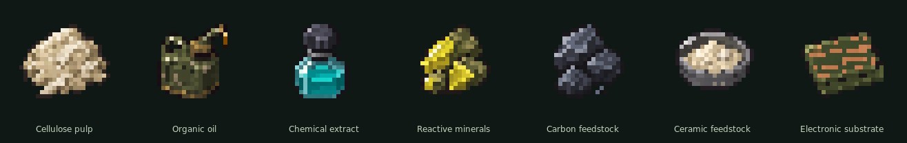
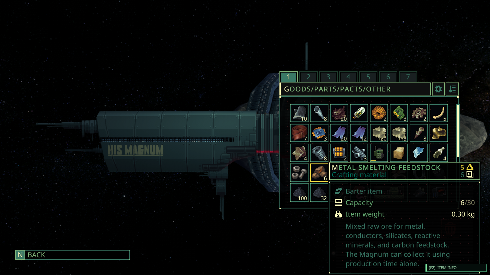
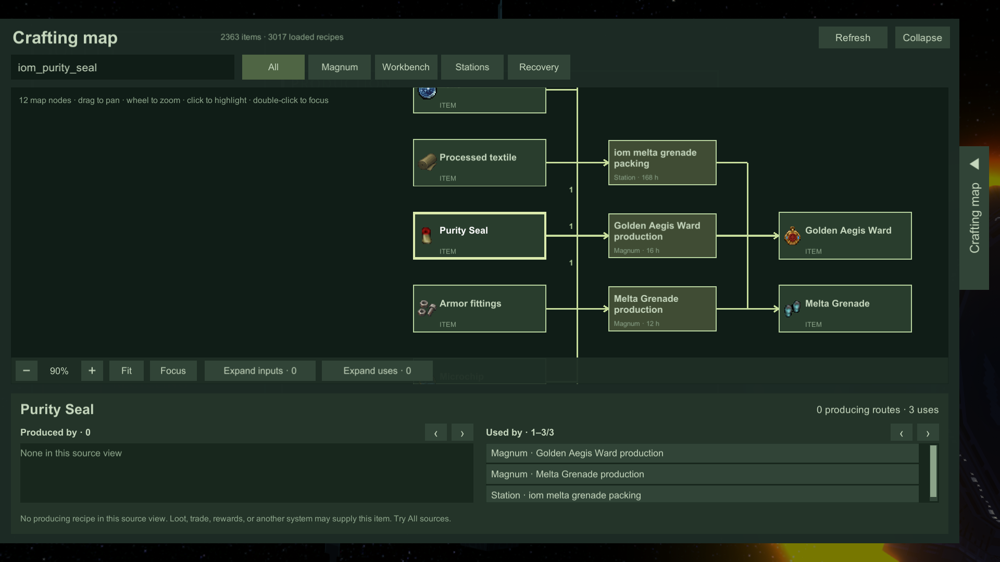

# Crafting map — download and screenshots

## Current verified native test package: 1.1.11

**[Download ImperiumOfMan-1.1.11-CraftingMap.zip](https://raw.githubusercontent.com/mrcalzon02/ImperiumOfMan/2c5f6dc35a6d41c63440a8c78c7dc01f31e826f3/package/ImperiumOfMan-1.1.11-CraftingMap.zip)** · [Open the ZIP's GitHub file page](https://github.com/mrcalzon02/ImperiumOfMan/blob/2c5f6dc35a6d41c63440a8c78c7dc01f31e826f3/package/ImperiumOfMan-1.1.11-CraftingMap.zip)

[Published source b89e15990b42d8bc4911237d5d1502fe0c283d99](https://github.com/mrcalzon02/ImperiumOfMan/commit/b89e15990b42d8bc4911237d5d1502fe0c283d99) adds native menu styling and compact button fixes, separated processing families and clearer routes, recipe icons, registered-recipe ingredient tracing, seven new material artworks, two manufacturing intermediates and paid Ore Cargo stock at three suppliers. [Candidate notes](CHANGE_NOTES_1.1.11.txt) · [Material quantities and timing](../../diagnostics/ManufacturingIntermediates.md).

[Installation instructions](../../package/README.md#install-the-verified-1111-package-for-testing) · [Published build receipt](../../diagnostics/CraftingMapBuildReceipt-1.1.11.json) · [Native build run](https://github.com/mrcalzon02/Dens-Mortis/actions/runs/45886658790).

| Package detail | Verified value |
| --- | --- |
| Assembly | 1.1.11.0 |
| Compiled source | `b89e15990b42d8bc4911237d5d1502fe0c283d99` |
| ZIP size | 11,819,417 bytes |
| SHA-256 | `db5e72f9202d8303fdacf467af04fb7f9d59412fd5ea05d41652eb9df9bdd539` |
| Native compilation | Passed; zero warnings/errors in 9.68 seconds |
| Package verification | Passed: 31 transport chunks, ZIP CRC/hashes, four runtime members, assembly version, TMP and compiled graph/dependency methods |
| Current game acceptance | Incomplete; manual foreground step required |

**Verified native test package; in-game checks incomplete. A manual foreground step is required.** Sessions [012](https://github.com/mrcalzon02/Dens-Mortis/actions/runs/45892441444) and [013](https://github.com/mrcalzon02/Dens-Mortis/actions/runs/45894151252) stopped because Windows refused foreground activation, before a frame or any input action. No campaign was loaded with this binary. There are no current Crafting Map captures from these attempts, and layout, icons, intermediate recipes and a paid Ore Cargo purchase remain unverified in game. Sessions 009–013 restored the original package, preserved all 11 protected campaign files and removed their fixtures. No test game remains active. Resume requires Core30 to be available and the next Quasimorph test window to be brought to the foreground. [Runtime recovery and cleanup record](../../diagnostics/CraftingMapRuntimeRecovery-b89e159.json).

Ore Cargo top-ups require the configured owner: Rachmaninoff and Cinder require CoreWard; Cinder stops receiving this top-up if captured. Foundry Primaris remains Imperial. Production and trade can reduce available stock.

The earlier `e6c3026` appearance baseline is superseded by this expanded candidate; its [build and session-008 review](../../diagnostics/CraftingMapNativeStyleBaselineReceipt.json) remain separately attributed.

### New material artwork preview

This is a source asset preview of the seven new designs, **not an in-game capture**. Their inventory, floor and shadow variants total 21 sprites.

**[Open full-size asset preview](https://raw.githubusercontent.com/mrcalzon02/ImperiumOfMan/b89e15990b42d8bc4911237d5d1502fe0c283d99/docs/crafting/resource-icons-1.1.11.png)** · [Open GitHub file](https://github.com/mrcalzon02/ImperiumOfMan/blob/b89e15990b42d8bc4911237d5d1502fe0c283d99/docs/crafting/resource-icons-1.1.11.png)

## Historical verified package: 1.1.10

**[Download ImperiumOfMan-1.1.10-CraftingMap.zip](https://raw.githubusercontent.com/mrcalzon02/ImperiumOfMan/186e2b76464b91888101657caec5e5cd531c80bb/package/ImperiumOfMan-1.1.10-CraftingMap.zip)** · [Open the ZIP's GitHub file page](https://github.com/mrcalzon02/ImperiumOfMan/blob/186e2b76464b91888101657caec5e5cd531c80bb/package/ImperiumOfMan-1.1.10-CraftingMap.zip)

This package includes the finished-ration correction: Corpse Starch and Dirty Corpse Starch have no recovery route. Forward manufacturing, eligible spoiled-organic recovery, clone harvesting and equipment salvage remain.

[Installation instructions](../../package/README.md#install-the-verified-1110-package-for-testing) · [1.1.10 change notes](CHANGE_NOTES_1.1.10.txt) · [Published verification receipt](https://github.com/mrcalzon02/ImperiumOfMan/blob/186e2b76464b91888101657caec5e5cd531c80bb/diagnostics/FinishedRationBuildReceipt.json)

| Package detail | Verified value |
| --- | --- |
| Assembly | 1.1.10.0 |
| Compiled source | `5fae43b49ff9fe4ee21cb88a3e8e30eb8e3558ad` |
| ZIP size | 11,794,130 bytes |
| SHA-256 | `8af3889a259a8a988d7e2a154d4a87af653b59b3a05de5c9616a32e529e00cf1` |
| Native compilation | Passed; zero warnings and zero errors |
| Package verification | Passed: ZIP, four runtime members, hashes, embedded artwork and compiled correction |
| 1.1.10 game boot and gameplay | Not run |

## Historical 1.1.9 game screenshots

These are original captures from **session 007**, run [45869745770](https://github.com/mrcalzon02/Dens-Mortis/actions/runs/45869745770), using source `347de7d` and assembly **1.1.9.0**. Their attribution remains separate from the newer 1.1.10 package. [Frame hashes and acceptance record](../../diagnostics/CraftingMapAcceptance-347de7d-007.json).

Each image has an explicit **full-size PNG** link and a **GitHub file** link beneath its preview. The links are pinned to the published image commit so they keep referring to these exact captures.

### Feedstock before production

The native item tooltip identifies **Metal smelting feedstock**, with **2/30** in the selected stack before the production order.

**[Open full-size PNG](https://raw.githubusercontent.com/mrcalzon02/ImperiumOfMan/2d71d38620b741aca3513e1a2d9993e1b6058298/docs/crafting/native-crafting-feedstock-before-347de7d-007.png)** · [Open GitHub file](https://github.com/mrcalzon02/ImperiumOfMan/blob/2d71d38620b741aca3513e1a2d9993e1b6058298/docs/crafting/native-crafting-feedstock-before-347de7d-007.png)

### Feedstock after production

The same named stack shows **6/30** after one four-output batch. The before/after pair records an exact **+4 change in that stack**.

**[Open full-size PNG](https://raw.githubusercontent.com/mrcalzon02/ImperiumOfMan/2d71d38620b741aca3513e1a2d9993e1b6058298/docs/crafting/native-crafting-feedstock-after-347de7d-007.png)** · [Open GitHub file](https://github.com/mrcalzon02/ImperiumOfMan/blob/2d71d38620b741aca3513e1a2d9993e1b6058298/docs/crafting/native-crafting-feedstock-after-347de7d-007.png)

### Station recipe with two outputs

The Stations view retains **2 Processed textile + 1 Moldable polymer stock → 8 Flak laminate + 8 Fitted armor liner**, with **120 base hours** shown for the inspected recipe.

**[Open full-size PNG](https://raw.githubusercontent.com/mrcalzon02/ImperiumOfMan/2d71d38620b741aca3513e1a2d9993e1b6058298/docs/crafting/native-crafting-station-cooutputs-347de7d-007.png)** · [Open GitHub file](https://github.com/mrcalzon02/ImperiumOfMan/blob/2d71d38620b741aca3513e1a2d9993e1b6058298/docs/crafting/native-crafting-station-cooutputs-347de7d-007.png)

### Search for an item without a producer

The All view finds **Purity Seal** and reports **0 producing routes and 3 uses**, keeping the item visible even when no registered producer exists.

**[Open full-size PNG](https://raw.githubusercontent.com/mrcalzon02/ImperiumOfMan/2d71d38620b741aca3513e1a2d9993e1b6058298/docs/crafting/native-crafting-no-producer-347de7d-007.png)** · [Open GitHub file](https://github.com/mrcalzon02/ImperiumOfMan/blob/2d71d38620b741aca3513e1a2d9993e1b6058298/docs/crafting/native-crafting-no-producer-347de7d-007.png)

## Evidence and version history

[Session-007 acceptance](../../diagnostics/CraftingMapAcceptance-347de7d-007.json) records the named-stack result, Focus and double-click, station cooutputs, no-producer search, the inspected 12-node graph at 40% Fit, and restoration of the original package and campaign files. [Execution history](../../diagnostics/CraftingMapHeadedValidation.md) retains the earlier tests and their scope.

The [historical 1.1.9 crafting notes](CHANGE_NOTES_1.1.9_CRAFTING_MAP.txt) describe the binary used for these captures. The [1.1.10 notes](CHANGE_NOTES_1.1.10.txt) describe the subsequent ration correction. The older 1.1.9 ZIP contains the removed ration recovery route; the verified 1.1.10 download above includes that correction. The [1.1.11 notes](CHANGE_NOTES_1.1.11.txt) describe the newer verified native test package, whose in-game checks remain incomplete.

