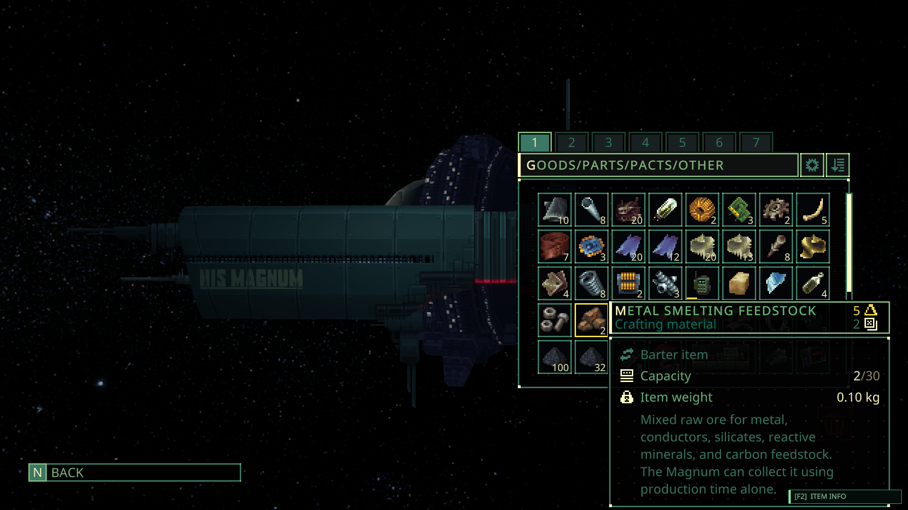
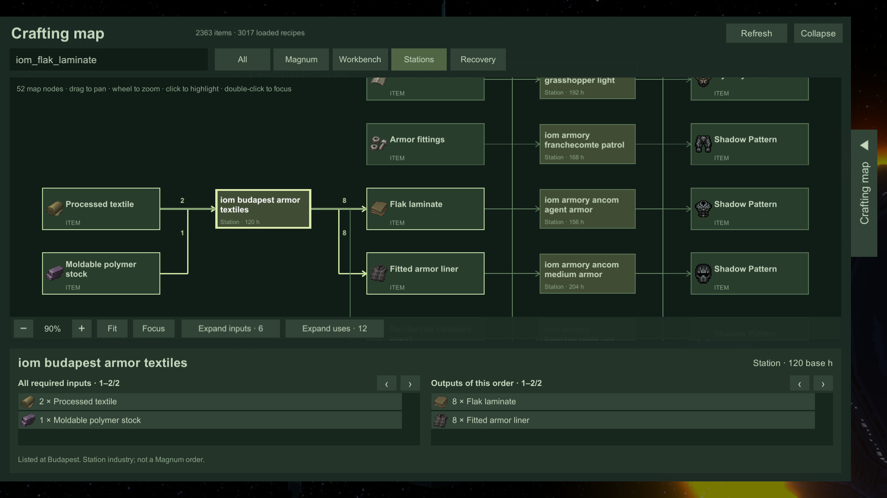

# Crafting map — download and screenshots

## Current verified package: 1.1.10

**[Download ImperiumOfMan-1.1.10-CraftingMap.zip](https://raw.githubusercontent.com/mrcalzon02/ImperiumOfMan/186e2b76464b91888101657caec5e5cd531c80bb/package/ImperiumOfMan-1.1.10-CraftingMap.zip)** · [Open the ZIP's GitHub file page](https://github.com/mrcalzon02/ImperiumOfMan/blob/186e2b76464b91888101657caec5e5cd531c80bb/package/ImperiumOfMan-1.1.10-CraftingMap.zip)

This package includes the finished-ration correction: Corpse Starch and Dirty Corpse Starch have no recovery route. Forward manufacturing, eligible spoiled-organic recovery, clone harvesting and equipment salvage remain.

[Installation instructions](../../package/README.md#install-the-verified-1110-package-for-testing) · [1.1.10 change notes](CHANGE_NOTES_1.1.10.txt) · [Published verification receipt](https://github.com/mrcalzon02/ImperiumOfMan/blob/186e2b76464b91888101657caec5e5cd531c80bb/diagnostics/FinishedRationBuildReceipt.json)

| Package detail | Verified value |
| --- | --- |
| Assembly | 1.1.10.0 |
| Compiled source | `5fae43b49ff9fe4ee21cb88a3e8e30eb8e3558ad` |
| ZIP size | 11,794,130 bytes |
| SHA-256 | `8af3889a259a8a988d7e2a154d4a87af653b59b3a05de5c9616a32e529e00cf1` |
| Native compilation | Passed; zero warnings and zero errors |
| Package verification | Passed: ZIP, four runtime members, hashes, embedded artwork and compiled correction |
| 1.1.10 game boot and gameplay | Not run |

## Game screenshots

These are original captures from **session 007**, run [45869745770](https://github.com/mrcalzon02/Dens-Mortis/actions/runs/45869745770), using source `347de7d` and assembly **1.1.9.0**. Their attribution remains separate from the newer 1.1.10 package. [Frame hashes and acceptance record](../../diagnostics/CraftingMapAcceptance-347de7d-007.json).

Each image has an explicit **full-size PNG** link and a **GitHub file** link beneath its preview. The links are pinned to the published image commit so they keep referring to these exact captures.

### Feedstock before production

The native item tooltip identifies **Metal smelting feedstock**, with **2/30** in the selected stack before the production order.

**[Open full-size PNG](https://raw.githubusercontent.com/mrcalzon02/ImperiumOfMan/2d71d38620b741aca3513e1a2d9993e1b6058298/docs/crafting/native-crafting-feedstock-before-347de7d-007.png)** · [Open GitHub file](https://github.com/mrcalzon02/ImperiumOfMan/blob/2d71d38620b741aca3513e1a2d9993e1b6058298/docs/crafting/native-crafting-feedstock-before-347de7d-007.png)

### Feedstock after production

The same named stack shows **6/30** after one four-output batch. The before/after pair records an exact **+4 change in that stack**.

**[Open full-size PNG](https://raw.githubusercontent.com/mrcalzon02/ImperiumOfMan/2d71d38620b741aca3513e1a2d9993e1b6058298/docs/crafting/native-crafting-feedstock-after-347de7d-007.png)** · [Open GitHub file](https://github.com/mrcalzon02/ImperiumOfMan/blob/2d71d38620b741aca3513e1a2d9993e1b6058298/docs/crafting/native-crafting-feedstock-after-347de7d-007.png)

### Station recipe with two outputs

The Stations view retains **2 Processed textile + 1 Moldable polymer stock → 8 Flak laminate + 8 Fitted armor liner**, with **120 base hours** shown for the inspected recipe.

**[Open full-size PNG](https://raw.githubusercontent.com/mrcalzon02/ImperiumOfMan/2d71d38620b741aca3513e1a2d9993e1b6058298/docs/crafting/native-crafting-station-cooutputs-347de7d-007.png)** · [Open GitHub file](https://github.com/mrcalzon02/ImperiumOfMan/blob/2d71d38620b741aca3513e1a2d9993e1b6058298/docs/crafting/native-crafting-station-cooutputs-347de7d-007.png)

### Search for an item without a producer

The All view finds **Purity Seal** and reports **0 producing routes and 3 uses**, keeping the item visible even when no registered producer exists.

**[Open full-size PNG](https://raw.githubusercontent.com/mrcalzon02/ImperiumOfMan/2d71d38620b741aca3513e1a2d9993e1b6058298/docs/crafting/native-crafting-no-producer-347de7d-007.png)** · [Open GitHub file](https://github.com/mrcalzon02/ImperiumOfMan/blob/2d71d38620b741aca3513e1a2d9993e1b6058298/docs/crafting/native-crafting-no-producer-347de7d-007.png)

## Evidence and version history

[Session-007 acceptance](../../diagnostics/CraftingMapAcceptance-347de7d-007.json) records the named-stack result, Focus and double-click, station cooutputs, no-producer search, the inspected 12-node graph at 40% Fit, and restoration of the original package and campaign files. [Execution history](../../diagnostics/CraftingMapHeadedValidation.md) retains the earlier tests and their scope.

The [historical 1.1.9 crafting notes](CHANGE_NOTES_1.1.9_CRAFTING_MAP.txt) describe the binary used for these captures. The current [1.1.10 notes](CHANGE_NOTES_1.1.10.txt) describe the subsequent ration correction. The older 1.1.9 ZIP contains the removed ration recovery route; use the 1.1.10 download above for that correction.

