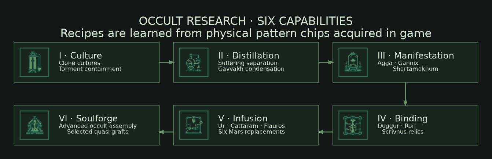

# Crafting map and occult reference

The current source implements six occult research capabilities, independent physical pattern chips, the clone-to-Gavvakh chain, and the in-game Crafting Map. Native build and gameplay evidence are tracked in [Occult research](../../diagnostics/OccultResearchExpansion.md) and [Organic recycling](../../diagnostics/OccultOrganicProduction.md).

## Open the map

Open [recipe-map.html](recipe-map.html) in a browser. Its data is embedded, so it works offline. Search for an item, choose Magnum/station/all sources, inspect producer recipes, expand the upstream trace, or select a downstream consumer.

Enable **Include conditional recipe candidates** to inspect occult additions that may be omitted when an installed native formula already exists or a required item is absent. Conditional candidates are hidden initially. The in-game Crafting Map reads the accepted live catalogue and the current campaign's recipe knowledge, capability and cargo.

The offline snapshot is pinned to source commit `347de7db77f9121ad26e1c12c534b97760ee92f2`, version **1.1.9.0**. Its **751 captured records** comprise 368 unconditional Magnum source records, 303 station records, and 80 conditional Magnum candidates. This includes **53 new occult candidates** and their **21 declared physical pattern-chip pools**. The recipes, literal quantities, pools and reference diagrams are unchanged from the prior snapshot; this refresh changes source provenance only. Source counts do not establish the number registered by the installed game, and this snapshot does not relabel the earlier `bdb1759` runtime observations.

## Six capabilities and acquired knowledge



This reference diagram uses the actual exported research icons. The current 347 headed game check confirmed the six-node arrangement, five adjacent links, Culture's dim green available image and the five crimson locked images. Research progresses through **Culture, Distillation, Manifestation, Binding, Infusion and Soulforge**, with exactly six purchases and no separate facility levels. Purchased states remain a separate check.

Research buys the capability to use a class of formulas. Each physical pattern chip teaches one selected recipe from its small pool. Production needs both requirements. The offline recipe details show these separately and preserve the occult formulas' literal quantities; the ordinary half-input/double-output helper is not applied to them.

## Files

| File | Purpose |
| --- | --- |
| [Source graph JSON](recipe-graph.json) | Captured records, exact known quantities, source provenance, conditional rules and unresolved cases |
| [Capability SVG](occult-capabilities.svg) / [PNG](occult-capabilities.png) | Six-node research sequence; SVG embeds the actual runtime icons |
| [Research sprites](occult-research-ranks.png) | All six green normal images and corresponding crimson locked images |
| [Current ship screenshot](native-occult-ship-347de7d.png) / [source and evidence](native-occult-ui-347de7d.json) | Exact-source 347 marker placement, corrected-directory simulation and verified cleanup |
| [Current research tree](native-occult-tree-347de7d.png) | Six nodes, five adjacent links, green available and crimson locked states |
| [Culture tooltip](native-occult-culture-347de7d.png) / [Manifestation tooltip](native-occult-manifestation-347de7d.png) | Both text-fit fixes verified, with native status, costs and yellow hover retained |
| [Native tree screenshot](native-occult-tree-bdb1759.png) / [source and hash](native-occult-tree-bdb1759.json) | Unmodified frame 0014 from the `bdb1759` headed session; predates the tooltip text fixes committed at `8563a18` |
| [Inventory sprites](occult-starter-sprites.png) | Clone, imprint, essence and physical pattern-chip icon/floor/shadow versions |
| [Art manifest](../../media/OccultProduction/art-manifest.json) | Prompts and paths for 10 generated masters and 24 runtime variants, six-node IDs/links, and provenance of the separate user-provided reference |
| [Original Navigation style guide](../../media/OccultProduction/Reference/navigation-technology-tree.png) | One unmodified user-provided reference image; not generated artwork or gameplay validation |
| [Occult research details](../../diagnostics/OccultResearchExpansion.md) | Purchase samples, knowledge-source groups, capability gates and verification status |
| [Organic production details](../../diagnostics/OccultOrganicProduction.md) | Exact four-step production quantities and selected recycling behavior |
| [Native build receipt](../../diagnostics/OccultBuildReceipt.json) | Verified 347 compilation, archive, artwork, session-005 map observations and the bounded session-006 corrected-context check and both current tooltip hovers |
| [Raw-material SVG](raw-material-overview.svg) / [PNG](raw-material-overview.png) | Ordinary chemistry routes with effective input quantities |
| [Crafting expansion design](../../CRAFTING_TREE_EXPANSION_DESIGN.md) | Broader design and future work beyond the current live browser |
| [Historical occult proposal](../../OCCULT_PRODUCTION_DESIGN.md) | Original equipment and worldbuilding ideas; superseded by the six-capability implementation where they differ |

Keep the folder structure when extracting a review ZIP so companion links continue to work. The complete HTML itself works independently.

## Rebuild the reference

Run from the repository root with Python 3 and Graphviz installed:

```sh
python tools/crafting/export_source_graph.py --ref 347de7db77f9121ad26e1c12c534b97760ee92f2 --out /tmp/occult-source-graph.json
python tools/crafting/build_source_map.py --graph /tmp/occult-source-graph.json
```

The bounded exporter recognizes the reviewed source helpers and the six explicit Mars replacement variants. It retains unresolved calls. A changed helper may need a corresponding exporter change. Native-only recipes, active station state, inventory, learned schematics and accepted runtime registration results require the live game view.

The offline manufacturing graph and current `CraftingCoverage` reachability report omit `ShredProfiles`. A blocked flag for `bone_knife`, `impaler` or `skrivnus_knife` can therefore reflect the missing `human_rib` recovery edge: selected Raw Clone harvest supplies one rib. Such source-only coverage flags do not prove those ingredients or routes are unobtainable.

The older `occult-proposal.*` files remain historical design drawings. Their proposed facility structure does not describe the current six-purchase tree. The current capability drawing and its source are `occult-capabilities.*`.

## Verification scope

The source export captures all 53 new occult candidates with a capability and physical knowledge source, including all six Mars parts. Exact starter batches are 2 clones, 4 imprints, 4 essence and 2 Gavvakh, with baseline times 8/4/4/4 hours. No occult parse calls are unresolved. JavaScript syntax, graph generation and the rendered capability reference were checked.

The art exporter produced 24 runtime sprites with the required RGBA dimensions, matching normal/locked silhouettes, green normal borders and crimson locked borders. All 24 were verified in both the historical `bdb1759` and current 347 DLLs. The regenerated reference diagrams are unchanged; the sheets above remain asset previews.

The current source combines the strict organic-destination selector, native Pact-component project-cloning compatibility, concise occult tooltip rows and map refinements. Native build [45838490203](https://github.com/mrcalzon02/Dens-Mortis/actions/runs/45838490203) **passed with zero warnings and zero errors** for source `347de7db77f9121ad26e1c12c534b97760ee92f2`, assembly **1.1.9.0**. The [current receipt](../../diagnostics/OccultBuildReceipt.json) records the canonical [runtime review candidate](../../package/ImperiumOfMan-1.1.9-CraftingMap.zip) and its exact hashes.

Exact-source [session 005](https://github.com/mrcalzon02/Dens-Mortis/actions/runs/45841032741) loaded the disposable campaign, retained the Ron Mask pact component and selected the intended seven spoiled-organic records. Map entry, both detail scrollbars and final rows, wheel isolation, selected-edge quantities, Fit, Escape and owner lifetime passed their bounded checks. A one-batch raw-ore order entered and later left the native queue; no pre-order aggregate was captured, so exact four-unit cargo delivery remains unverified. [Sanitized acceptance cases and frame hashes](../../diagnostics/CraftingMapAcceptance-347de7d.json).

Space simulation in that original launch context encountered an empty global preset catalogue. [Loader audit 45849018302](https://github.com/mrcalzon02/Dens-Mortis/actions/runs/45849018302) verified the relative `GameData/BinaryPresetsMap.json` lookup and silent empty-map fallback. Corrected-directory [session 006](https://github.com/mrcalzon02/Dens-Mortis/actions/runs/45849635092) used that same binary and completed Space/save plus 46 hours 20 minutes of in-game time. The full 15,897-byte log has zero missing-preset diagnostics and zero managed-exception headings. Focused [run 45857447221](https://github.com/mrcalzon02/Dens-Mortis/actions/runs/45857447221) subsequently verified the shorter `Recipes` label and all three Manifestation Materials names in full, retaining native status, costs and yellow hover. Exact recycling, capability purchases, chip learning, cancellation/refunds and purchased/item sprite states retain their separate test scope.

The original package was restored at session-005 operator stop sequence 42. All 11 protected campaign files were unchanged; six remaining owned fixture files were archived and removed, with no retained or unexpected campaign files. Session 006 later ended at sequence 32 with the original package restored, original saves unchanged and its fixture cleaned. The focused tooltip session also stopped at sequence 17 with the original package restored, original saves unchanged and fixture cleanup complete. The [design review ZIP](ImperiumReforged-Crafting-Design-Review.zip) includes the current source, reusable artwork, original reference, verified native captures and companion documents. It contains no runtime binaries.

The earlier `585715f` candidate is superseded. Historical `bdb1759` boot/load, six-node tree, midpoint pip and pre-fix tooltip observations remain in the [archived receipt](../../diagnostics/OccultBuildReceipt-bdb1759.json) and unmodified screenshot manifest. Those images do not prove the later tooltip changes. The bdb session's operator stop at sequence 21 and cleanup delivery `bd04d4a192cefee80a2acaf7ed3ee3f58d857729` remain historical evidence.
